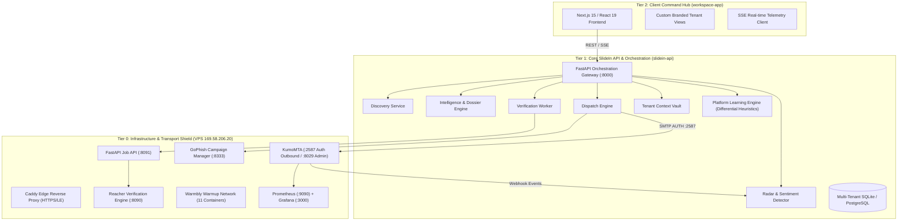
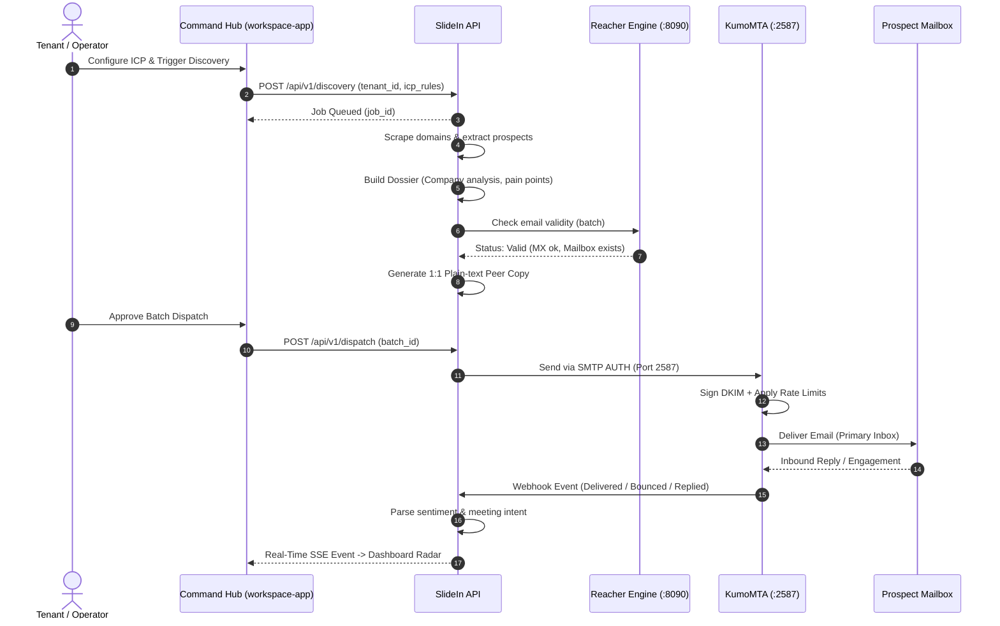

# SlideIn — Technical Architecture Specification

> **Authority note (2026-10-16):** This root file is a high-level summary created before the engagement capability was documented.
> Where it differs from `docs/` (canonical layout, ADR-0002), **`docs/` prevails**. Figures marked as targets here (placement %, latency, price/cost,
> thresholds) are **proposals, not confirmed requirements**. Prospect Engagement (reply → chat/voice → meeting booking):
> `docs/product/PROSPECT_ENGAGEMENT.md`.


> **Version:** 1.0.0  
> **Status:** Draft summary (see docs/ for canonical)  
> **System Scope:** End-to-end Multi-Tenant Agentic Outreach & Deliverability Platform  
> **Production VPS:** `169.58.206.20` (Ubuntu, Docker, Caddy, KumoMTA, GoPhish, Warmbly)  

---

## 1. System Topology Overview

SlideIn is structured into three distinct, decoupled tiers:



---

## 2. Platform Learning vs. Tenant Isolation Pattern

### 2.1 The Founder's Dilemma
When a client subscribes, the agent runs continuously on their behalf. The client's business operates in a specific niche with proprietary target lists, value propositions, and customer dialogues. 
**The Risk:** Without rigorous architectural boundaries, the AI agent will either:
1. Suffer from *Tenant Drift* — warping the core software to serve only that specific client's business logic.
2. Suffer from *Data Contamination* — leaking proprietary tactics, leads, or messaging nuances from Tenant A to Tenant B.

### 2.2 The 3-Layer Solution

```
+--------------------------------------------------------------------------+
| LAYER 3: TENANT-SPECIFIC EPHEMERAL CONTEXT (Strictly Partitioned)       |
| - ICP definitions, target personas, company offering                     |
| - Prospect contact details & scraped company dossiers                    |
| - Generated email copy, custom sequences, active conversations           |
| - Invariant: Encrypted at rest, filtered by tenant_id, zero leakage      |
+--------------------------------------------------------------------------+
                                    |
                                    v (Anonymized feature extraction only)
+--------------------------------------------------------------------------+
| LAYER 2: PLATFORM GENERAL HEURISTICS (The "Platform Genome")             |
| - Statistical optimal send windows (e.g. B2B tech opens peak 8:45am EST)  |
| - Subject line structural syntax (e.g. 2-4 word informal questions)     |
| - Email deliverability reputation signals per ESP                        |
| - Spam filter trigger patterns and deliverability feedback               |
| - Invariant: Strictly zero PII, zero business secrets, zero copy reuse   |
+--------------------------------------------------------------------------+
                                    |
                                    v
+--------------------------------------------------------------------------+
| LAYER 1: IMMUTABLE CORE SYSTEM PRINCIPLES (The Acquisition Engine)       |
| - 1:1 Peer-to-peer tone guidelines                                       |
| - Deliverability gatekeeper & circuit breaker protocols                  |
| - Pre-send verification requirements (MX, mailbox, disposable check)     |
| - Multi-tenant security contracts & audit trails                         |
+--------------------------------------------------------------------------+
```

### 2.3 Implementation Mechanism
- **Row-Level Security (RLS):** Every database table carries an index on `tenant_id`. Every SQL query without exception includes `WHERE tenant_id = :current_tenant`.
- **Tenant Context Namespaces:** Vector embeddings and semantic memory use partitioned tenant namespaces (`tenant_{id}_vectors`).
- **Differential Heuristic Aggregation:** The Platform Genome only consumes aggregated histograms and statistical summaries (e.g., aggregate open rate vs subject line word count), never raw email text or prospect names.

---

## 3. Tier Specifications

### 3.1 Tier 0: Infrastructure & Transport (`169.58.206.20`)
- **Host OS:** Ubuntu LTS with Docker runtime and systemd supervision.
- **KumoMTA:**
  - Inbound SMTP listener on `127.0.0.1:2587` requiring SASL plain authentication (`outbound`).
  - Production policy defined in `kumomta-lab/policy/production_init.lua`.
  - Automated DKIM signing with 2048-bit keys across all active domains:
    - `nasrullahtanim.me` (selector: `default`)
    - `tanim.social` (selector: `default`)
    - `tanim.tech` (selector: `default`)
  - Provider rate limits: Max 50 msgs/hr for Gmail, 100 msgs/hr for Microsoft 365, strict concurrency limits per MX.
- **Verification Engine (Reacher):**
  - Reacher backend on `127.0.0.1:8090` performing real SMTP RCPT TO handshakes.
  - Job API on `127.0.0.1:8091` handling async batch queues.
- **Edge Reverse Proxy (Caddy):**
  - Handles automated Let's Encrypt certificates.
  - Exposes public HTTPS for dashboard, tracking pixels, and warm-up endpoints.
  - Strictly binds internal APIs (`:2587`, `:8029`, `:8333`, `:8090`, `:8091`, `:3000`) to loopback.

### 3.2 Tier 1: SlideIn Core API (`slidein-api`)
- **Runtime:** Python 3.11+ / FastAPI with async SQLAlchemy.
- **Authentication:** Bearer token authentication with tenant-scoped JWTs and API keys.
- **Core Endpoints:**
  - `/api/v1/discovery`: Target search, scraping job orchestration.
  - `/api/v1/intelligence`: Prospect dossier creation and web synthesis.
  - `/api/v1/verification`: Batch email verification via Reacher.
  - `/api/v1/dispatch`: Outbound queue manager connecting to KumoMTA.
  - `/api/v1/radar`: Inbound webhooks, reply parsing, sentiment classification.
  - `/api/v1/telemetry`: SSE event stream for live dashboard updates.
  - `/api/v1/tenants`: Tenant profile, custom ICP settings, and branded view configuration.

### 3.3 Tier 2: SaaS Command Hub (`workspace-app`)
- **Runtime:** Next.js 15 (App Router), React 19, TypeScript.
- **Styling Architecture:**
  - Tailwind CSS v4 with custom OKLCH token layer matching SlideIn Venture design system.
  - CSS variables for macro contrast (`--surface`, `--on-surface`, `--muted`, `--rule`, `--accent`).
  - Two-axis theme model: Day (`paper-50`) vs Night (`ink-deep`), with per-band section tones (`base`, `raised`, `anchor`, `terminal`).
- **Telemetry Streaming:** Real-time event consumption via SSE (`/api/v1/telemetry/stream`), rendering live dispatch progress and incoming replies without page reloads.

---

## 4. End-to-End Execution Sequence



---

## 5. Security & Multi-Tenant Boundaries

1. **Database Partitioning:** All data storage (SQLite/PostgreSQL) strictly isolates tenant records.
2. **SMTP Authentication:** Outbound mail submission requires authenticated credentials.
3. **No Direct Public MTA Access:** KumoMTA injection port `2587` is bound exclusively to `127.0.0.1` and protected by firewalls.
4. **Data Isolation Tests:** Automated test suites verify that attempting to query Tenant B's records with Tenant A's session token results in an immediate `403 Forbidden` error.

---

## 6. Engagement Layer (PROPOSED)

Inbound Gateway, Thread Resolver, Policy Engine, Knowledge Service, Reply/Chat Agent, Booking Service, Notification Service, Audit Ledger.
Details: `docs/architecture/ENGAGEMENT_ARCHITECTURE.md`. Known gap: no production inbound mail path yet (`docs/project/CURRENT_STATE.md` #23).
