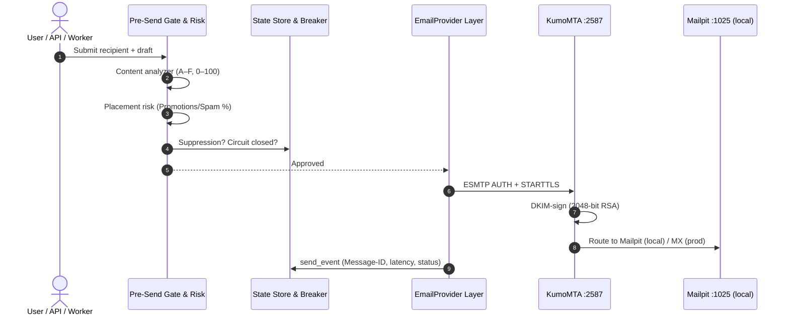

# Data Flow — SlideIn

## Outbound (verified live 2026-10-12)

Composition (`advanced_deliverability.py`): RFC 5322 assembly with
configurable MUA headers, Spintax expansion, niche pitch, pacing. Local
egress is forced to Mailpit by policy — verified: the e2e recipient was a
`.local` dummy and the message was retrieved from the sink.

## Inbound events

Provider webhooks (`/webhook/ses|sendgrid|postmark|mailgun|generic`) →
`core/webhook.py` parsers → `delivery_events` + `delivery_stats`. SNS
subscription confirmation is allowlisted (SNS hosts, https-only,
no-redirect). Bounce/complaint parsers feed suppression; the breaker trips
on threshold breach.

## Conversational loop (verified live)

`/v1/leads/submit` → speed-to-lead dispatch → `/v1/inbound/webhook`
(MIME/JSON parse, intent classify) → optional AI auto-reply → thread
stitching by Message-ID. Platform suite proved a 3-message thread with
stage advancement to `booked`.

## What does NOT flow

- Local stacks never emit internet email (policy-forced sinks).
- Suppressed recipients never reach dispatch (enforced at every live
  send site; 403/skip + audit event).
- Cross-workspace reads/writes are rejected (404).
