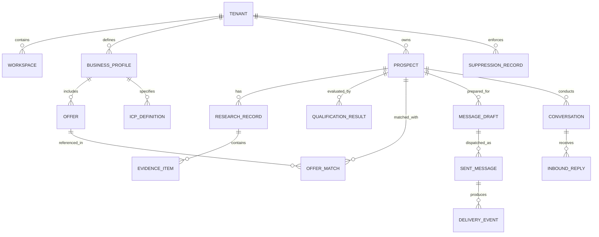

# SLIDEIN CANONICAL DATA MODEL

> **Entity Relationship Specification & Schema Architecture**  
> Status: Active Specification  
> Version: 1.0.0

---

## 1. Domain Entities & Relationships

---

## 2. Table Specifications

### 2.1 Tenant & Business Foundation

#### `tenants`
- `id`: VARCHAR(64) PRIMARY KEY (e.g., `ten_01H...`)
- `name`: VARCHAR(255) NOT NULL
- `slug`: VARCHAR(64) UNIQUE NOT NULL
- `plan_tier`: VARCHAR(32) DEFAULT 'standard' (`starter`, `standard`, `enterprise`)
- `autonomy_level`: INT DEFAULT 1 (0=Research, 1=Review Required, 2=Co-pilot, 3=Autonomous)
- `is_active`: BOOLEAN DEFAULT true
- `created_at`: TIMESTAMPTZ DEFAULT NOW()
- `updated_at`: TIMESTAMPTZ DEFAULT NOW()

#### `business_profiles`
- `id`: VARCHAR(64) PRIMARY KEY
- `tenant_id`: VARCHAR(64) NOT NULL REFERENCES tenants(id) ON DELETE CASCADE
- `legal_name`: VARCHAR(255) NOT NULL
- `website_url`: VARCHAR(255) NOT NULL
- `industry`: VARCHAR(128) NOT NULL
- `company_description`: TEXT NOT NULL
- `core_value_prop`: TEXT NOT NULL
- `markets_served`: TEXT[] DEFAULT '{}'
- `created_at`: TIMESTAMPTZ DEFAULT NOW()
- `updated_at`: TIMESTAMPTZ DEFAULT NOW()

#### `offers`
- `id`: VARCHAR(64) PRIMARY KEY
- `tenant_id`: VARCHAR(64) NOT NULL REFERENCES tenants(id) ON DELETE CASCADE
- `profile_id`: VARCHAR(64) NOT NULL REFERENCES business_profiles(id) ON DELETE CASCADE
- `name`: VARCHAR(255) NOT NULL
- `summary`: TEXT NOT NULL
- `pain_points_solved`: TEXT[] DEFAULT '{}'
- `target_persona`: VARCHAR(255) NOT NULL
- `proof_points`: TEXT[] DEFAULT '{}'
- `is_active`: BOOLEAN DEFAULT true

#### `icp_definitions`
- `id`: VARCHAR(64) PRIMARY KEY
- `tenant_id`: VARCHAR(64) NOT NULL REFERENCES tenants(id) ON DELETE CASCADE
- `name`: VARCHAR(255) NOT NULL
- `industries`: TEXT[] DEFAULT '{}'
- `company_size_min`: INT DEFAULT 1
- `company_size_max`: INT DEFAULT 5000
- `geographies`: TEXT[] DEFAULT '{}'
- `target_roles`: TEXT[] DEFAULT '{}'
- `required_signals`: TEXT[] DEFAULT '{}'
- `exclusion_keywords`: TEXT[] DEFAULT '{}'
- `is_active`: BOOLEAN DEFAULT true

---

### 2.2 Prospecting & Research

#### `prospects`
- `id`: VARCHAR(64) PRIMARY KEY
- `tenant_id`: VARCHAR(64) NOT NULL REFERENCES tenants(id) ON DELETE CASCADE
- `first_name`: VARCHAR(128)
- `last_name`: VARCHAR(128)
- `email`: VARCHAR(255) NOT NULL
- `phone`: VARCHAR(64)
- `company_name`: VARCHAR(255) NOT NULL
- `company_domain`: VARCHAR(255)
- `job_title`: VARCHAR(255)
- `linkedin_url`: VARCHAR(255)
- `source`: VARCHAR(64) NOT NULL (`csv_import`, `web_crawler`, `search_api`, `manual`)
- `status`: VARCHAR(32) DEFAULT 'discovered' (`discovered`, `researching`, `qualified`, `disqualified`, `draft_ready`, `in_campaign`, `replied`, `opted_out`)
- `qualification_score`: INT DEFAULT 0 (0-100)
- `created_at`: TIMESTAMPTZ DEFAULT NOW()
- `updated_at`: TIMESTAMPTZ DEFAULT NOW()
- CONSTRAINT uq_tenant_email UNIQUE(tenant_id, email)

#### `evidence_items`
- `id`: VARCHAR(64) PRIMARY KEY
- `tenant_id`: VARCHAR(64) NOT NULL REFERENCES tenants(id) ON DELETE CASCADE
- `prospect_id`: VARCHAR(64) NOT NULL REFERENCES prospects(id) ON DELETE CASCADE
- `evidence_type`: VARCHAR(64) NOT NULL (`company_news`, `hiring_signal`, `tech_stack`, `exec_quote`, `website_claim`)
- `claim_text`: TEXT NOT NULL
- `source_url`: VARCHAR(1024) NOT NULL
- `confidence`: NUMERIC(3, 2) DEFAULT 1.00
- `verification_status`: VARCHAR(32) DEFAULT 'verified' (`verified`, `inferred`, `unverified`)
- `retrieved_at`: TIMESTAMPTZ DEFAULT NOW()

#### `qualification_results`
- `id`: VARCHAR(64) PRIMARY KEY
- `tenant_id`: VARCHAR(64) NOT NULL REFERENCES tenants(id) ON DELETE CASCADE
- `prospect_id`: VARCHAR(64) NOT NULL REFERENCES prospects(id) ON DELETE CASCADE
- `icp_id`: VARCHAR(64) NOT NULL REFERENCES icp_definitions(id)
- `score`: INT NOT NULL (0-100)
- `is_qualified`: BOOLEAN NOT NULL
- `matching_criteria`: JSONB DEFAULT '[]'
- `missing_criteria`: JSONB DEFAULT '[]'
- `explanation`: TEXT NOT NULL
- `evaluated_at`: TIMESTAMPTZ DEFAULT NOW()

---

### 2.3 Outreach & Controlled Dispatch

#### `message_drafts`
- `id`: VARCHAR(64) PRIMARY KEY
- `tenant_id`: VARCHAR(64) NOT NULL REFERENCES tenants(id) ON DELETE CASCADE
- `prospect_id`: VARCHAR(64) NOT NULL REFERENCES prospects(id) ON DELETE CASCADE
- `offer_id`: VARCHAR(64) REFERENCES offers(id)
- `subject`: VARCHAR(512) NOT NULL
- `body`: TEXT NOT NULL
- `version`: INT DEFAULT 1
- `status`: VARCHAR(32) DEFAULT 'pending_review' (`pending_review`, `approved`, `rejected`, `sent`, `cancelled`)
- `attributed_evidence_ids`: TEXT[] DEFAULT '{}'
- `human_edited`: BOOLEAN DEFAULT false
- `approved_by`: VARCHAR(64)
- `approved_at`: TIMESTAMPTZ
- `created_at`: TIMESTAMPTZ DEFAULT NOW()

#### `sent_messages`
- `id`: VARCHAR(64) PRIMARY KEY
- `tenant_id`: VARCHAR(64) NOT NULL REFERENCES tenants(id) ON DELETE CASCADE
- `draft_id`: VARCHAR(64) NOT NULL REFERENCES message_drafts(id)
- `prospect_id`: VARCHAR(64) NOT NULL REFERENCES prospects(id)
- `sender_email`: VARCHAR(255) NOT NULL
- `recipient_email`: VARCHAR(255) NOT NULL
- `message_id`: VARCHAR(512) UNIQUE NOT NULL
- `transport`: VARCHAR(64) NOT NULL (`kumomta_smtp`, `gophish_api`)
- `delivery_status`: VARCHAR(32) DEFAULT 'submitted' (`submitted`, `accepted`, `delivered`, `bounced`, `deferred`, `complained`)
- `sent_at`: TIMESTAMPTZ DEFAULT NOW()

#### `suppression_records`
- `id`: VARCHAR(64) PRIMARY KEY
- `tenant_id`: VARCHAR(64) REFERENCES tenants(id) ON DELETE CASCADE -- null if global
- `email`: VARCHAR(255) NOT NULL
- `domain`: VARCHAR(255)
- `reason`: VARCHAR(64) NOT NULL (`opt_out`, `hard_bounce`, `spam_complaint`, `manual_admin`)
- `suppressed_at`: TIMESTAMPTZ DEFAULT NOW()
- CONSTRAINT uq_suppression UNIQUE(COALESCE(tenant_id, 'GLOBAL'), email)

---

### 2.4 Conversations & Inbound

#### `inbound_replies`
- `id`: VARCHAR(64) PRIMARY KEY
- `tenant_id`: VARCHAR(64) NOT NULL REFERENCES tenants(id) ON DELETE CASCADE
- `prospect_id`: VARCHAR(64) NOT NULL REFERENCES prospects(id)
- `original_sent_message_id`: VARCHAR(64) REFERENCES sent_messages(id)
- `sender_email`: VARCHAR(255) NOT NULL
- `subject`: VARCHAR(512) NOT NULL
- `body`: TEXT NOT NULL
- `thread_id`: VARCHAR(512)
- `intent`: VARCHAR(64) DEFAULT 'unclassified' (`interested`, `information_request`, `objection`, `out_of_office`, `unsubscribe`, `not_interested`)
- `intent_confidence`: NUMERIC(3, 2) DEFAULT 0.00
- `requires_action`: BOOLEAN DEFAULT true
- `received_at`: TIMESTAMPTZ DEFAULT NOW()
