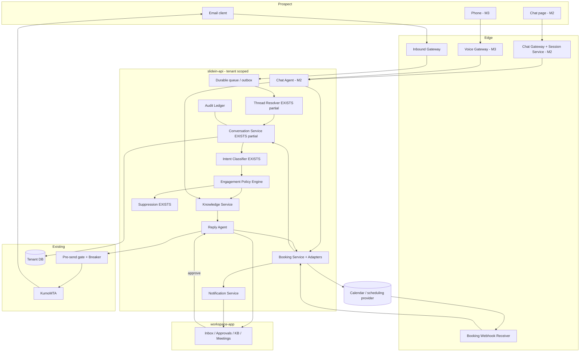
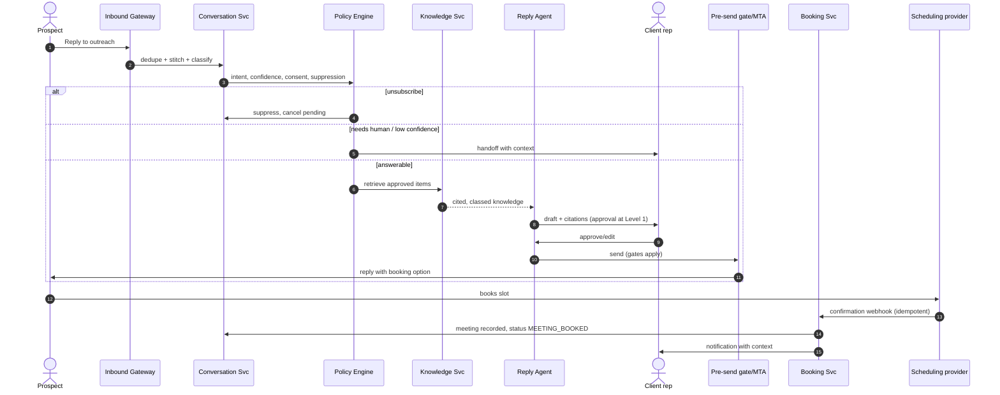
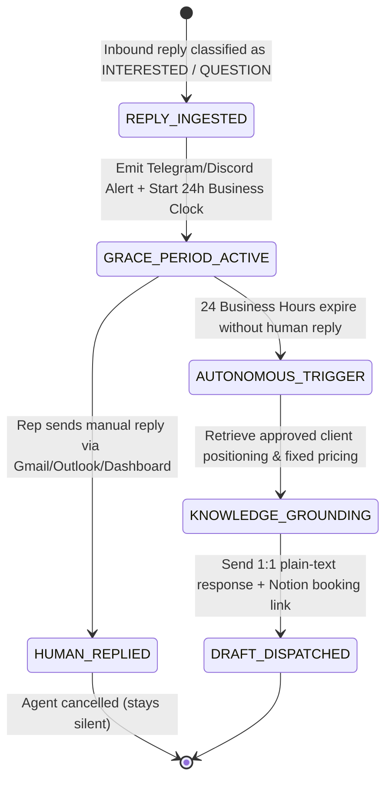

# SLIDEIN ENGAGEMENT ARCHITECTURE (Replies, Chat, Voice, Booking)

> Status: **PROPOSED architecture** — nothing here is built or approved unless marked `EXISTS`.
> Version 0.1.0 (2026-10-16). Product spec:
> [`../product/PROSPECT_ENGAGEMENT.md`](../product/PROSPECT_ENGAGEMENT.md).
> Authoritative current architecture remains [`SYSTEM_ARCHITECTURE.md`](SYSTEM_ARCHITECTURE.md).
> No new technology stack is introduced: everything below extends the existing FastAPI
> `slidein-api`, the Next.js `workspace-app`, KumoMTA, and the tenant model. Provider choices are open decisions.

---

## 1. Integration boundaries

| Concern | Existing component | Extension |
|---|---|---|
| Email submission | KumoMTA :2587, pre-send gate, suppression | Agent replies use the **same** gate |
| Inbound email | `POST /webhooks/inbound` (`EXISTS`, `services/conversations.py`); `imap/` Go package (legacy) | **Production inbound path missing** (`CURRENT_STATE` #23). Decision PD-01 |
| Threading & intent | `Conversation`, `InboundReply`, `In-Reply-To` lookup, intent classifier (`EXISTS`) | Add message model, filters, fallback tokens |
| Prospect/campaign records | `prospects`, `sent_messages`, lifecycle | Add engagement sub-states |
| Knowledge | Business profile, offers, `evidence_items`, tenant memory policy | Add approved-knowledge items + classes |
| AI | Vercel AI SDK / Anthropic/OpenAI adapters (`DOC` INTEGRATIONS) | Grounded reply/chat orchestration |
| Calendar/booking | none | New booking adapter boundary (PD-02) |
| Notifications | none wired (`CURRENT_STATE` #17 notifier absent) | New notification service |
| Voice | none | Deferred voice gateway (PD-05) |
| Console UI | `workspace-app` (leads, mail, opportunities, agents) | Inbox/handoff, KB editor, approvals |

## 2. Components



### Responsibilities

| Component | Responsibility | Never does |
|---|---|---|
| Inbound Gateway | Receive MIME, authenticate source, enqueue raw message | Interpret content |
| Thread Resolver | Map message → tenant/prospect/campaign/conversation; flag ambiguity | Guess silently |
| Intent Classifier | Intent + confidence (existing) | Send anything |
| Policy Engine | Decide: auto / draft-for-approval / escalate / suppress, by autonomy level, intent, confidence, consent, kill switch | Bypass suppression |
| Knowledge Service | Tenant-scoped retrieval of **approved, unexpired** items with class + citation | Return unapproved content |
| Reply/Chat Agent | Draft/answer grounded in KS output; output carries citations & info classes | State uncited facts, prices, availability |
| Booking Service | Provider-neutral operations: offer, create (idempotent), reschedule, cancel; record meetings | Say "booked" before provider confirmation |
| Notification Service | Alert reps (email/Slack TBD) | Contain more PII than needed |
| Audit Ledger | Append-only record of decisions/actions | Be editable |

## 3. Reply sequence (M1)



## 4. Proposed data model additions (all `tenant_id`, UTC timestamps)

*Proposed; extend `DATA_MODEL.md` only when approved.*

| Table | Key columns | Purpose |
|---|---|---|
| `conversation_messages` | id, tenant_id, conversation_id, channel(email/chat/voice), direction, author_type(prospect/agent/human/system), body, info_class, citations[], external_message_id(unique per tenant), created_at | Unified thread (extends `inbound_replies`) |
| `engagement_sessions` | id, tenant_id, prospect_id, campaign_id, token_hash, expires_at, revoked_at, channel, status | Chat/link sessions |
| `knowledge_items` | id, tenant_id, class, title, body, shareable_externally, version, approved_by, approved_at, expires_at | Approved knowledge |
| `meetings` | id, tenant_id, prospect_id, conversation_id, rep_id, meeting_type, starts_at, tz, provider, provider_event_id(unique), status, source_channel, qualification jsonb | Bookings |
| `consent_records` | id, tenant_id, prospect_id, channel, basis, source, granted_at, revoked_at | Preferences/consent |
| `call_records` | id, tenant_id, prospect_id, direction, consent_id, summary, outcome, recording_ref, retention_until | Voice (M3) |
| `agent_actions` / audit | id, tenant_id, actor, action, subject, details, created_at | Append-only audit |
| `unanswered_questions` | id, tenant_id, conversation_id, question, status | KB improvement queue |

Prospect lifecycle extension (proposed, after `REPLIED`):
`REPLIED → ENGAGING → MEETING_PROPOSED → MEETING_BOOKED`, with side exits `HUMAN_OWNED`, `STALLED`, `CLOSED_NOT_INTERESTED`, `OPTED_OUT` (any state).

## 5. Booking Adapter Architecture (Notion Calendar Primary)

```typescript
export interface BookingProvider {
  /** Primary adapter: Notion Calendar / Database integration */
  readonly providerName: "notion_calendar" | "dedicated_link_sync";
  
  /** List bookable slots or fetch live availability */
  listAvailability(repId: string, meetingType: string, windowDays: number, timeZone: string): Promise<TimeSlot[]>;
  
  /** Create or confirm a scheduled meeting */
  createBooking(request: BookingCreationRequest): Promise<BookingResult>;
  
  /** Reschedule or cancel */
  rescheduleBooking(bookingId: string, newSlot: TimeSlot): Promise<BookingResult>;
  cancelBooking(bookingId: string, reason: string): Promise<void>;
  
  /** Parse and authenticate inbound confirmation webhooks */
  verifyWebhook(request: Request): Promise<BookingEvent>;
}
```

### 5.1 Provider Hierarchy
1. **Primary Default: Notion Booking Calendar (`NotionCalendarAdapter`)**
   - Directly binds with the client's Notion Calendar workspace and booking database.
   - Zero third-party fees; fully integrated with client meeting notes and representative agendas.
2. **Secondary Fallback: Dedicated Booking Link Sync (`DedicatedLinkSyncAdapter`)**
   - Ingests and routes appointments booked via existing Cal.com, Calendly, or custom client scheduling links.

---

## 6. Real-Time Notification & Inbound Telemetry Service

- **Telegram Bot API:** Dispatches structured Markdown alert cards to client Telegram groups/chats upon reply ingest, interest detection, or booking confirmation.
- **Discord Webhook:** Posts embed summaries to the client's `#leads` or `#acquisitions` channels.
- **Slack Webhook:** Enterprise channel notification option.
- **Email Digest:** Immediate notification sent to representative email.

---

## 7. The 24-Hour Business Grace Period Scheduler



- **Business Clock Calculation:** Excludes US weekends (Saturday & Sunday) and official US Federal Holidays.
- **Zero Hallucination / Pricing Constraint:** The agent strictly communicates the fixed monthly rate established in the knowledge base, with **zero authority to negotiate**.

---

## 8. Confirmed Architecture Decisions

| ID | Decision | Confirmed Architectural Resolution | Status |
|---|---|---|---|
| **PD-01** | Inbound Email Path | **Dual Architecture:** KumoMTA webmail dashboard viewer + Google Workspace / Microsoft 365 IMAP/OAuth sync. | **APPROVED** |
| **PD-02** | Booking Provider | **Notion Booking Calendar** primary default, with dedicated link sync fallback (Cal.com / Calendly). | **APPROVED** |
| **PD-03** | Agent Autonomy | **24-Hour Business Grace Period:** Human priority; autonomous fallback after 24 business hours. | **APPROVED** |
| **PD-04** | Chat Hosting | Tenant-branded route on `workspace-app` behind cryptographically hashed single-prospect session tokens. | **APPROVED (M2)** |
| **PD-05** | Voice Provider | Inbound / callback-only receptionist via buy/white-label platform (Retell AI). Unsolicited outbound calls **BLOCKED**. | **PLANNED (M3)** |
| **PD-06** | Link Delivery Standard | **Zero links on cold first-touch outreach.** Booking and chat links provided exclusively upon prospect interest. | **APPROVED** |
| **PD-07** | Pricing Authority | **Non-Negotiable Fixed Pricing:** Hardcoded guardrails prevent agents from offering discounts or custom terms. | **APPROVED** |

