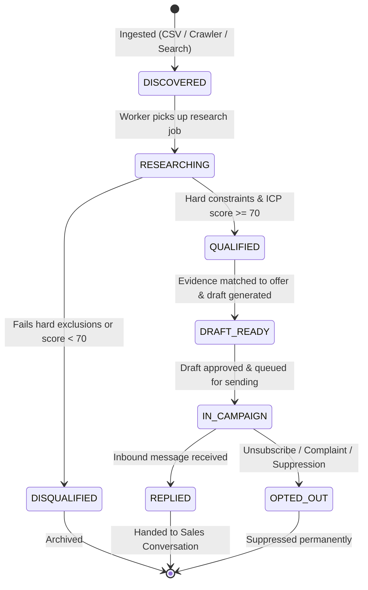
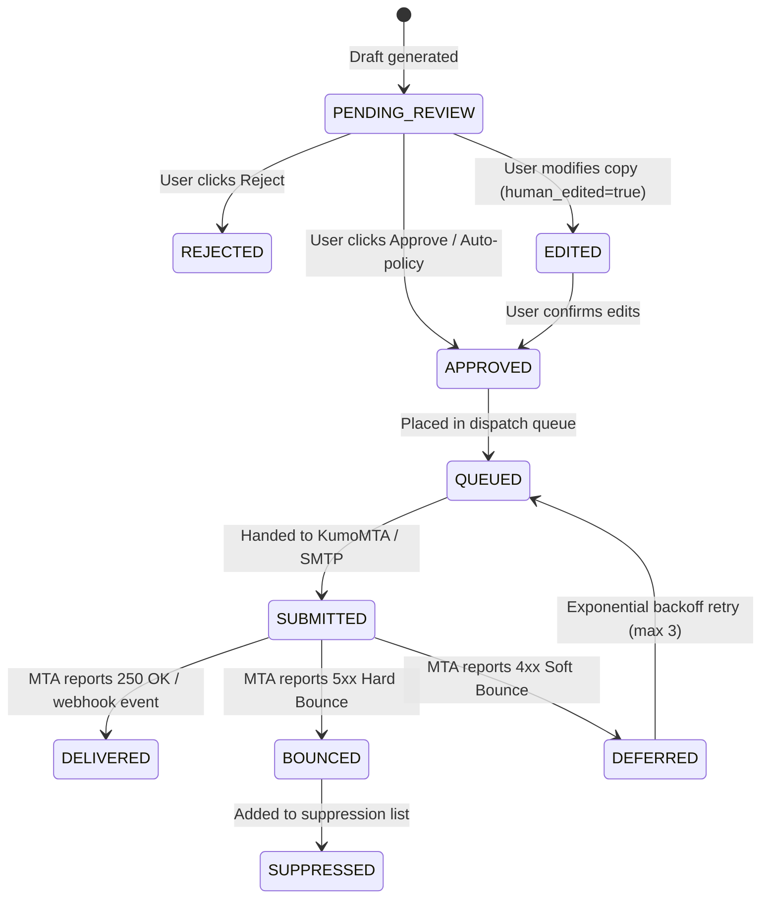

# SLIDEIN WORKFLOW LIFECYCLE & STATE MACHINES

> **Deterministic State Transitions, Concurrency & Failure Recovery**  
> Status: Active Specification  
> Version: 1.0.0

---

## 1. Prospect State Machine

### Transition Guards:
- `DISCOVERED` $\rightarrow$ `RESEARCHING`: Requires active tenant status, valid company domain or website.
- `RESEARCHING` $\rightarrow$ `QUALIFIED`: Requires at least 1 verified `evidence_item` and qualification evaluation.
- `QUALIFIED` $\rightarrow$ `DRAFT_READY`: Requires matched active `offer` and positive anti-spam scoring.
- `DRAFT_READY` $\rightarrow$ `IN_CAMPAIGN`: Requires explicit human approval if autonomy level $= 1$.
- Any state $\rightarrow$ `OPTED_OUT`: Triggered immediately upon opt-out request or complaint.

---

## 2. Message Draft & Dispatch Lifecycle

---

## 3. Workflow Run & Job Recovery Machine

Every scheduled or triggered workflow runs through a durable state machine:
1. `CREATED`: Task registered with unique idempotency key: `run_${tenant_id}_${stage}_${date}`.
2. `VALIDATING`: Pre-flight check verifies tenant status, sending rate limits, and circuit breaker status. If tripped, transitions immediately to `PAUSED_CIRCUIT_BREAKER`.
3. `RUNNING`: Executes batch processing with a strict concurrency lock (per-tenant mutex).
4. `RETRYING`: Transient errors (rate limits from search API, temporary MTA socket timeout) trigger exponential backoff with jitter: $T = 2^n \times 10\text{s} \pm \text{jitter}$ (Max attempts: 3).
5. `FAILED`: Permanent errors (auth failure, invalid format, corrupt data) halt the step, record the failure payload, and notify the operator without crashing the process.
6. `COMPLETED`: Emits summary metrics, releases locks, and updates next scheduled run time.
