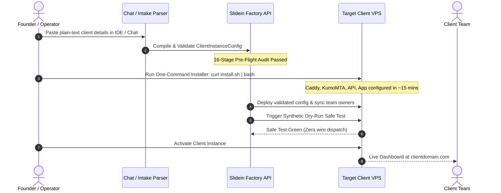

# Architecture: Slidein Client Instance Platform

> **Status:** Accepted & Implemented (Initial Release v1.0)  
> **Author:** Slidein Engineering Architecture  
> **Date:** 2026-10-16  
> **Core Tenet:** One codebase, zero client-specific code forks, one-command deployment, isolated client instances.

---

## 1. Executive Summary & Assessment: Plan B (Dedicated Instance) vs. Plan A (Shared Multi-Tenant)

### The Strategic Decision: **Plan B (Dedicated Client Instance / VPS)**

To launch rapidly and operate reliably with zero unnecessary technical complexity, **Plan B is the definitive choice for Slidein v1.**

| Evaluation Vector | Plan A (Shared Multi-Tenant VPS) | Plan B (Dedicated Client Instance / VPS) — **CHOSEN** |
| :--- | :--- | :--- |
| **Deliverability & IP Reputation** | **High Risk:** One client with poor lists or high spam complaints poisons the shared IP, degrading delivery for all other clients. | **Complete Isolation:** Dedicated IP pool and sending domain per client. Zero cross-tenant reputation contamination. |
| **Data Security & Privacy** | Requires complex row-level security (RLS), tenant scoping guards on every query, and shared cache partitioning. | **Physical Blast Radius:** Client database, logs, and artifacts reside on an isolated file system / host. |
| **Custom Domains & SSL** | Wildcard Caddy setup, complex DNS verification, multi-tenant cert renewal risks. | **Automated Zero-Touch TLS:** Native Caddy reverse-proxy automatically provisions Let's Encrypt certificates for the client's domain. |
| **Onboarding Speed** | Must carefully isolate database migrations and tenant configuration within a shared database. | **Under 2 Hours (Target: ~45 min):** Run the one-command installer on a fresh Ubuntu host, inject the validated config, and launch. |
| **Client Customization** | Difficult to tailor dashboard terminology or widgets without complex client-gated feature flags. | **Configuration-Driven:** The same release image reads the client's `deployment_config.json` to dynamically render branding and widgets. |
| **Maintenance & Offboarding** | Offboarding requires complex data expungement and key revocation across shared tables. | **Trivial Ops:** Archiving a client is as simple as creating a database backup and snapshotting/shutting down their VPS. |

---

## 2. Platform Topology: The Single-Host Client Footprint

Each client instance runs as a self-contained, lightweight, hardened stack on an Ubuntu LTS host (e.g., Hetzner CX22/CPX21 or DigitalOcean 2 vCPU / 4GB RAM, cost: ~$10–$18/mo).

```
                             Internet
                                │
                 ┌──────────────▼──────────────┐
                 │    Caddy 2 (Reverse Proxy)   │  Auto-issued Let's Encrypt TLS
                 │  - app.clientdomain.com     │  HTTP/2 & HTTP/3 termination
                 │  - api.clientdomain.com     │
                 └──────┬──────────────┬───────┘
                        │              │
         ┌──────────────▼──────┐  ┌────▼─────────────────────────┐
         │     slidein-app     │  │          slidein-api          │
         │   (Next.js 15 BFF)  │  │   (FastAPI Workflow Engine)   │
         │  Port 3000 (PM2)    │  │   Port 8100 (systemd)         │
         │                     │  │                               │
         │  - Role-scoped UI   │  │  - 8-Stage StageRunner        │
         │    (Founder/Rep)    │  │  - Deterministic Router       │
         │  - Dynamic Branding │  │  - Statutory Cold-Email Gate  │
         │  - Terminology Map  │  │  - Quarantine Circuit Breaker │
         └──────────────┬──────┘  └────┬──────────────────────────┘
                        │              │
                        │ API Bearer   │ Local SQLite / Postgres
                        └──────────────► Data & Audit State
                                       │
                 ┌─────────────────────┴─────────────────────────┐
                 │               Mail Infrastructure              │
                 │  - KumoMTA (Local SMTP relay on loopback:2587) │
                 │  - DKIM signing / SPF / DMARC verification    │
                 │  - Webhook delivery / bounce listener         │
                 └───────────────────────────────────────────────┘
```

---

## 3. Configuration-Driven Architecture (Zero Code Forks)

A client instance is fully defined by two artifacts:
1. **Application Release:** Pinned Git commit or container release of the universal Slidein codebase.
2. **Validated Deployment Configuration:** A JSON document adhering to the `ClientInstanceConfig` schema.

```json
{
  "$schema": "https://slideinventure.com/schemas/client-config-v1.json",
  "client_id": "ten_harbor_dental",
  "version": 1,
  "identity": {
    "business_name": "Harbor Dental Partners",
    "base_domain": "outreach.harbordental.com",
    "industry": "Healthcare & Dental Clinics",
    "primary_color": "#0ea5e9",
    "logo_url": "https://assets.harbordental.com/logo.png"
  },
  "terminology": {
    "prospect": "Dental Practice",
    "lead_owner": "Regional Director",
    "meeting": "Partnership Consultation"
  },
  "modules": [
    "overview",
    "discovery",
    "research",
    "qualification",
    "personalization",
    "outreach",
    "conversations"
  ],
  "sending_policy": {
    "sender_email": "partnerships@outreach.harbordental.com",
    "physical_postal_address": "Suite 400, 100 Harbor Way, Portland, OR 97201",
    "lawful_basis": "B2B legitimate interest, verified practice registry",
    "daily_cap": 50,
    "hourly_cap": 10,
    "require_approval": true
  },
  "team_owners": [
    {
      "display_name": "Dr. Sarah Jenkins",
      "email": "sarah@harbordental.com",
      "crm_owner_id": "hub-101",
      "booking_provider": "cal",
      "booking_url": "https://cal.com/harbor/sarah-jenkins",
      "booking_verified": true
    }
  ]
}
```

---

## 4. Role Separation: Founder View vs. Employee / Rep View

Both roles run within the same application interface, dynamically customized through server-side role resolution:

### 1. Founder / Administrator View
* **Outcome Metrics:** Total prospects engaged, qualification conversion rates, meeting velocity.
* **Operational Control:** Approval queue for outbound drafts, sending rate limit controls, circuit breaker review.
* **Team Visibility:** Performance breakdown per team owner / loan officer.
* **System Health:** Live deliverability status (bounce rates, spam complaints, quarantine status).

### 2. Employee / Rep (e.g., Loan Officer, Practice Director) View
* **Focused Inbox:** Only displays prospects and conversations assigned directly to their `owner_id`.
* **Personal Calendar Link Status:** Verifies that their booking destination is active and tested.
* **Contextual History:** Displays research evidence items, prospect signals, and conversation threads for their leads.
* **Action Gating:** Cannot modify sending policies, bypass approvals, or alter company integrations.

---

## 5. Security & Isolation Invariants

1. **No Plaintext Secrets in Configuration:** Integration credentials (SMTP passwords, CRM API keys) are referenced by secure pointers (`secret_ref`), resolved from local root-owned environment files (`/opt/slidein/.secrets.env`).
2. **Failsafe Booking Resolution:** If a prospect is assigned to Rep A, but Rep A has no verified booking link or is deactivated, the message preparation fails closed (`HTTP 409 Conflict: booking_unverified`). It never substitutes Rep B's link.
3. **Statutory Outbound Gate:** The pre-send compliance gate verifies (a) physical postal address, (b) verified B2B lawful basis, (c) RFC 8058 `List-Unsubscribe` headers, and (d) clean circuit breaker before any message is dispatched.
4. **Local Network Binding:** KumoMTA, GoPhish, SQLite/Postgres, and backend APIs listen exclusively on localhost (`127.0.0.1`), exposed externally only through Caddy with authenticated TLS.

---

## 6. The <2-Hour Onboarding Lifecycle



* **Step 1 (15 min):** Intake client details (brand, domains, team members, calendar URLs).
* **Step 2 (5 min):** Automated compilation and pre-flight validation.
* **Step 3 (20 min):** One-tap VPS provisioning via `install.sh`.
* **Step 4 (10 min):** DNS propagation check (SPF, DKIM, DMARC, A records).
* **Step 5 (5 min):** Synthetic dry-run test and instance activation.
* **Total Time:** **~55 minutes** (well under the 2-hour target).
