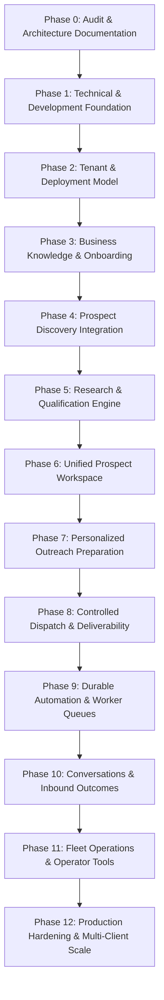
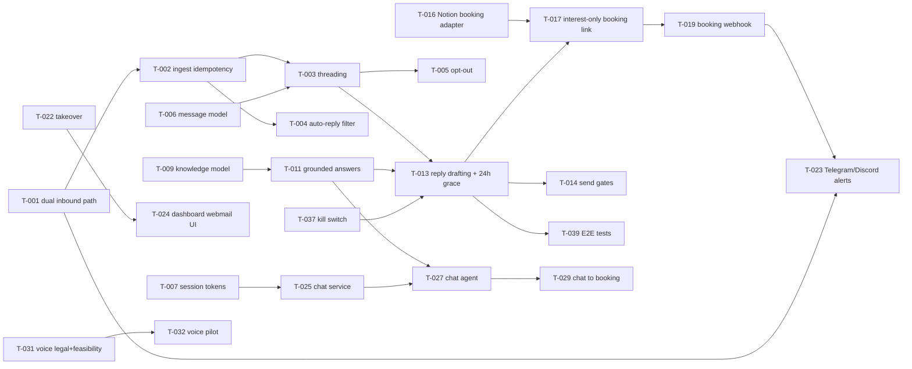

# SLIDEIN ENGINEERING IMPLEMENTATION ROADMAP

> **Ordered, Dependency-Driven Execution Roadmap (Phases 0–12)**  
> Status: Active Roadmap  
> Version: 1.0.0

---

## Roadmap Overview

---

## Detailed Phases & Exit Criteria

### Phase 0: Product Constitution & Repository Audit (CURRENT)
- **Objectives:** Complete code audit, assess `workspace-app`, document canonical architecture, contracts, security, and roadmap.
- **Exit Criteria:** All 17 architectural documents created and approved; clear delta between existing codebase and target architecture.

### Phase 1: Technical Foundation & Console Consolidation
- **Objectives:** Consolidate `workspace-app` as single operational console, establish shared TypeScript types, database connectivity, and environment validation.
- **Exit Criteria:** `npm run dev` and `npm run build` execute reliably; database connectivity test passes.

### Phase 2: Tenant & Deployment Foundation
- **Objectives:** Implement `Tenant` and `Deployment` domain models, tenant context extraction in server actions/routes, and membership permissions.
- **Exit Criteria:** Automated test proving complete tenant isolation (Tenant A cannot view or mutate Tenant B records).

### Phase 3: Business Knowledge & Onboarding
- **Objectives:** Build Business Profile, Offer Registry, Evidence Vault, ICP rule editor, and 12-factor Readiness Assessor.
- **Exit Criteria:** Operator can input client profile and offers; system computes real readiness score.

### Phase 4: First Working Prospect Discovery Integration
- **Objectives:** CSV batch ingestion and public web discovery adapter with deduplication, domain normalization, and idempotent persistence.
- **Exit Criteria:** Discovered prospects save cleanly with source attribution and show in the leads table.

### Phase 5: Research, Qualification & Offer Matching
- **Objectives:** Web research worker (Tavily/Search API), structured `evidence_items` persistence, explainable ICP scoring, and offer matching.
- **Exit Criteria:** Prospect receives explainable score ($0-100$) with sourced evidence citations.

### Phase 6: Unified Prospect Workspace
- **Objectives:** Polish `/leads` data table with filters for qualification score, offer match, evidence preview, and batch actions.
- **Exit Criteria:** Users can inspect full prospect profile, evidence cards, and qualification breakdown.

### Phase 7: Evidence-Grounded Personalized Outreach
- **Objectives:** Context-aware drafting engine referencing verified evidence; draft versioning, editing, deliverability scoring, and human approval flow.
- **Exit Criteria:** Generated draft includes zero fabricated claims; user can edit and approve draft.

### Phase 8: Controlled Dispatch & Deliverability Gating
- **Objectives:** Connect KumoMTA/GoPhish transport adapter; pre-send suppression checks; hourly rate limiting; delivery webhook processing.
- **Exit Criteria:** Approved draft sends via SMTP (port 2587); DKIM verifies; bounce/delivery status records.

### Phase 9: Durable Automation & Daily Operation
- **Objectives:** Persistent background schedules for discovery, research, drafting, and dispatch; circuit breakers; retry mechanisms.
- **Exit Criteria:** Background worker operates reliably across application restarts.

### Phase 10: Inbound Conversations & Outcomes
- **Objectives:** Inbound MIME webhook / IMAP sync; thread stitching; intent classifier (`interested`, `unsubscribe`, etc.); auto-suppression on opt-out.
- **Exit Criteria:** Inbound reply updates prospect stage; opt-out instantly prevents future emails.

### Phase 11: Fleet Operations & Internal Operator Console
- **Objectives:** Operator overview across client deployments, global delivery health, queue metrics, and provider cost tracking.
- **Exit Criteria:** Operator can deploy and monitor multiple independent client businesses from one screen.

### Phase 12: Production Hardening & Scale
- **Objectives:** End-to-end integration test suite, disaster recovery runbooks, multi-client security review, and backup verification.
- **Exit Criteria:** Full test suite passes; production readiness verified.

---

## Phase 10 Expansion: Prospect Engagement (Replies → Chat → Voice → Booking)

> Added 2026-10-16. Product spec: `docs/product/PROSPECT_ENGAGEMENT.md`. Architecture:
> `docs/architecture/ENGAGEMENT_ARCHITECTURE.md`. Open decisions: `docs/project/OPEN_QUESTIONS.md`.
> **Milestone 1 (M1: Reply-to-Meeting Loop) is APPROVED BY OWNER (2026-10-16).**
> - Inbound path: Dual (KumoMTA webmail dashboard viewer OR Google Workspace/M365 IMAP/OAuth sync).
> - Notifications: 24/7 background worker to Telegram Bot, Discord Webhook, Slack Webhook.
> - Scheduling: Notion Booking Calendar primary with custom link sync fallback.
> - Grace Period: 24 business hours (US business days only) for human rep before agent auto-replies.
> - First-Touch Link Rule: STRICTLY ZERO links in cold outreach; booking links only sent upon explicit interest.
> - Pricing Policy: Fixed monthly pricing; agents have zero discretion to discount or negotiate.

### Milestones

| Milestone | Scope | Exit criteria | Status |
|---|---|---|---|
| **M0 Prerequisites** | T-001, T-016 decision, approval enforcement, OQ P0 decisions | Decisions recorded; inbound path chosen; provider chosen | **COMPLETED** |
| **M1 Reply-to-Meeting Loop** (MVP candidate) | WS-A, WS-B(part), WS-C(min), WS-D, WS-E(link), WS-F, WS-I(min), WS-J(min) | A real reply is answered from approved knowledge (with 24h human grace period), Notion booking link sent on interest; Telegram/Discord alerted | **APPROVED & ACTIVE** |
| **M2 Chat agent** | WS-G, T-018, T-029, T-030, T-035 | Prospect chats via secure link, books, or is handed off | PLANNED |
| **M3 Voice add-on** | WS-H | Legal sign-off + inbound/callback pilot only | RESEARCH |
| **Blocked** | Automated outbound calls/SMS | Strictly BLOCKED (TCPA compliance + Owner directive) | BLOCKED |

### Dependency graph

### Task table

Columns: ID · deliverable · requirements · module/location · depends on · acceptance · verification · status · open decision.

| ID | Deliverable | Reqs | Location | Depends | Acceptance | Verification | Status | Open decision |
|---|---|---|---|---|---|---|---|---|
| **WS-A Inbound & reply handling** | | | | | | | | |
| T-001 | Production dual inbound path (KumoMTA webmail viewer & Google/M365 sync) | 001 | KumoMTA/DNS/`slidein-api` webhooks | – | Real reply lands in conversation <60 s | Live test via sink/real mailbox | IN PROGRESS | RESOLVED (Dual) |
| T-002 | Idempotent ingest (unique Message-ID per tenant), raw MIME retention | 002,112 | `services/conversations.py`, `models.py` | T-001 | Replay ×5 → 1 row | Unit + replay test | IN PROGRESS | – |
| T-003 | Robust threading + prospect/campaign association + ambiguity queue | 003 | `conversations.py` | T-002,T-006 | 20/20 fixtures; ambiguous → review | Fixture suite | IN PROGRESS | – |
| T-004 | Auto-reply/OOO/bounce/list-loop filtering; agent turn cap | 004 | `conversations.py` | T-002 | OOO yields no reply | Fixture suite | IN PROGRESS | – |
| T-005 | Opt-out hardening: cancel pending sends/agent drafts | 006 | `suppression.py`, queue | T-003 | Zero sends after stop | Automated e2e | IN PROGRESS | – |
| **WS-B Identity, storage, audit** | | | | | | | | |
| T-006 | `conversation_messages` model + migration (needs alembic, `TECHNICAL_DEBT`) | 010,026 | `models.py`, migrations | – | Unified ordered thread | Migration + API test | IN PROGRESS | – |
| T-007 | Engagement session/token service | 020,021 | new service | T-006 | Hashed, expiring tokens | Security unit tests | NOT STARTED | – |
| T-008 | Append-only audit ledger for agent actions | 111 | `activity.py` | T-006 | Entry per action | Audit test | NOT STARTED | – |
| **WS-C Knowledge** | | | | | | | | |
| T-009 | Approved knowledge model (non-negotiable monthly pricing, zero discount) | 080,082,084,085,116 | `models.py`, Knowledge module | – | Unapproved/discounted never retrievable | Boundary tests | IN PROGRESS | RESOLVED |
| T-010 | Knowledge editor + approval workflow | 080,083 | `workspace-app` Knowledge | T-009 | Admin approves/expires | UI + e2e test | NOT STARTED | – |
| T-011 | Grounded answer service with citations and refusal | 009,023,081,083 | `services/` new | T-009 | 0 fabricated facts on eval set | Eval suite | NOT STARTED | RESOLVED |
| T-012 | Adversarial eval set + guardrail policy | 081 | tests/eval | T-011 | Passing threshold agreed | CI eval | NOT STARTED | – |
| **WS-D Reply agent** | | | | | | | | |
| T-013 | Reply drafting + 24-hr US business day grace period scheduler | 005,007,009 | `conversations.py`, `services/scheduler.py` | T-003,T-011,T-037 | Auto-reply after 24 business hrs if human silent | Unit + timer tests | IN PROGRESS | RESOLVED |
| T-014 | Send path reuse: gate, breaker, limits, identity | 008 | `transport.py` | T-013 | Breaker blocks reply | Unit + live dry run | NOT STARTED | RESOLVED |
| T-015 | Escalation rules (low confidence, sensitive, unknown) | 005,081 | Policy engine | T-013 | Routes to human | Scenario tests | NOT STARTED | – |
| **WS-E Booking** | | | | | | | | |
| T-016 | Notion Booking Calendar adapter + fallback custom booking link sync | 060,061,114 | `services/booking.py` | – | Adapter contract tests pass | Contract tests | IN PROGRESS | RESOLVED (Notion) |
| T-017 | Scheduling-link flow in approved reply (INTEREST ONLY, 0 in cold) | 060,061,062 | RA + BS | T-013,T-016 | Zero links in cold; link in interest draft | Integration + cold check | IN PROGRESS | RESOLVED |
| T-018 | Direct availability/booking via API (M2) | 061,063,066 | BS | T-016 | No double booking | Race test | NOT STARTED | RESOLVED |
| T-019 | Booking webhook → `meetings`, status, never pre-confirm | 063,064,067 | BS | T-016,T-006 | Status MEETING_BOOKED on event only | Webhook replay test | NOT STARTED | – |
| T-020 | Reschedule/cancel handling | 065 | BS | T-019 | Records updated | Event tests | NOT STARTED | – |
| T-021 | Pre-call brief & reminders (link to Phase 12/14) | 069 | later | T-019 | – | – | DEFERRED | – |
| **WS-F Handoff & notifications** | | | | | | | | |
| T-022 | Human takeover/handback; agent pause | 100,025 | Policy engine, UI | T-006 | Agent silent after takeover | e2e | NOT STARTED | – |
| T-023 | 24/7 VPS Alert Dispatcher (Telegram Bot, Discord, Slack) | 064,102 | `services/notifications.py` | T-019 | Delivered per event within 15s | Provider mock + live check | IN PROGRESS | RESOLVED |
| T-024 | Dashboard webmail & conversation UI with full context | 010,101 | `workspace-app` mail/leads | T-006 | Context complete | UI test | IN PROGRESS | – |
| **WS-G Chat (M2)** | | | | | | | | |
| T-025 | Chat session service + secure link page | 020,021 | Chat gateway, `workspace-app` public route | T-007 | Token-bound session | Security test | NOT STARTED | RESOLVED |
| T-026 | Brand-compliant chat UI with AI disclosure and human button | 022,025 | `workspace-app`; brand per `docs/product/PROSPECT_ENGAGEMENT.md` §10 | T-025 | Disclosure 100% | Playwright | NOT STARTED | OQ-060..063 |
| T-027 | Chat agent orchestration (grounded, one job) | 023,024 | CA | T-011,T-025 | Scenario pass | Eval + e2e | NOT STARTED | – |
| T-028 | Qualification logic (configurable, non-blocking) | 027,068 | CA/BS | T-027 | Meeting-intent books directly | Scenario tests | NOT STARTED | OQ-011 |
| T-029 | Chat → booking | 060,064 | CA+BS | T-018 | Booking from chat | e2e | NOT STARTED | – |
| T-030 | Abandonment policy | 028 | Policy engine | T-025 | Limits respected | Fixture | NOT STARTED | OQ-013 |
| **WS-H Voice (M3)** | | | | | | | | |
| T-031 | Feasibility, provider and legal review; confirm no-outbound rule | 040 | docs | – | Written decision | Review sign-off | NOT STARTED | OQ-009,026,041 |
| T-032 | Inbound/callback voice pilot with AI disclosure, human transfer | 041,042,043,045 | Voice gateway | T-031,T-027 | Greeting + transfer verified | Call tests | NOT STARTED | – |
| T-033 | Call summary, outcome, recording/retention policy | 044 | call_records | T-032 | Policy enforced | Audit | NOT STARTED | OQ-043 |
| **WS-I Security, consent, privacy** | | | | | | | | |
| T-034 | Consent/preference model | 113 | `consent_records` | T-006 | Record per channel | Unit | NOT STARTED | OQ-042 |
| T-035 | Link hardening, rate limiting, abuse protection | 021 | Chat gateway | T-007 | Abuse tests pass | Security tests | NOT STARTED | – |
| T-036 | Retention & deletion jobs | 115 | worker | T-006 | Deletion verified | Test | NOT STARTED | OQ-044 |
| T-037 | Per-tenant & global emergency stop | 110 | Policy + send path | – | Stop halts sends | e2e | NOT STARTED | – |
| T-038 | Legal review checklist maintained | 117 | docs | – | Signed off | Review | NOT STARTED | OQ-040..046 |
| **WS-J Testing & ops** | | | | | | | | |
| T-039 | End-to-end suite on lab stack (sink MX): reply→answer→booking→opt-out | all M1 | `test_*`, lab | T-013,T-019 | Green | CI | NOT STARTED | – |
| T-040 | Monitoring/alerts: inbound lag, DLQ depth, agent error rate, booking failures | 112 | Prometheus/Grafana | T-001 | Alerts fire | Fire drill | NOT STARTED | – |
| T-041 | Operations runbook (incident, kill switch, provider outage) | 110,112 | `docs/operations` | T-037 | Reviewed | Tabletop | NOT STARTED | – |
