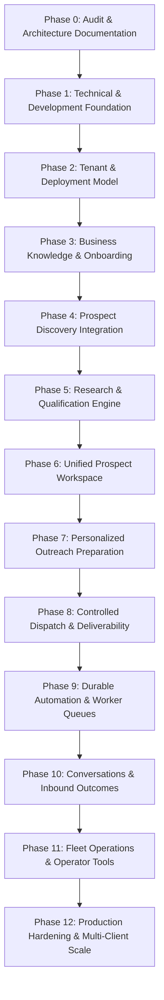

# SLIDEIN ENGINEERING IMPLEMENTATION ROADMAP

> **Ordered, Dependency-Driven Execution Roadmap (Phases 0–12)**  
> Status: Active Roadmap  
> Version: 1.0.0

---

## Roadmap Overview

---

## Detailed Phases & Exit Criteria

### Phase 0: Product Constitution & Repository Audit (CURRENT)
- **Objectives:** Complete code audit, assess `workspace-app`, document canonical architecture, contracts, security, and roadmap.
- **Exit Criteria:** All 17 architectural documents created and approved; clear delta between existing codebase and target architecture.

### Phase 1: Technical Foundation & Console Consolidation
- **Objectives:** Consolidate `workspace-app` as single operational console, establish shared TypeScript types, database connectivity, and environment validation.
- **Exit Criteria:** `npm run dev` and `npm run build` execute reliably; database connectivity test passes.

### Phase 2: Tenant & Deployment Foundation
- **Objectives:** Implement `Tenant` and `Deployment` domain models, tenant context extraction in server actions/routes, and membership permissions.
- **Exit Criteria:** Automated test proving complete tenant isolation (Tenant A cannot view or mutate Tenant B records).

### Phase 3: Business Knowledge & Onboarding
- **Objectives:** Build Business Profile, Offer Registry, Evidence Vault, ICP rule editor, and 12-factor Readiness Assessor.
- **Exit Criteria:** Operator can input client profile and offers; system computes real readiness score.

### Phase 4: First Working Prospect Discovery Integration
- **Objectives:** CSV batch ingestion and public web discovery adapter with deduplication, domain normalization, and idempotent persistence.
- **Exit Criteria:** Discovered prospects save cleanly with source attribution and show in the leads table.

### Phase 5: Research, Qualification & Offer Matching
- **Objectives:** Web research worker (Tavily/Search API), structured `evidence_items` persistence, explainable ICP scoring, and offer matching.
- **Exit Criteria:** Prospect receives explainable score ($0-100$) with sourced evidence citations.

### Phase 6: Unified Prospect Workspace
- **Objectives:** Polish `/leads` data table with filters for qualification score, offer match, evidence preview, and batch actions.
- **Exit Criteria:** Users can inspect full prospect profile, evidence cards, and qualification breakdown.

### Phase 7: Evidence-Grounded Personalized Outreach
- **Objectives:** Context-aware drafting engine referencing verified evidence; draft versioning, editing, deliverability scoring, and human approval flow.
- **Exit Criteria:** Generated draft includes zero fabricated claims; user can edit and approve draft.

### Phase 8: Controlled Dispatch & Deliverability Gating
- **Objectives:** Connect KumoMTA/GoPhish transport adapter; pre-send suppression checks; hourly rate limiting; delivery webhook processing.
- **Exit Criteria:** Approved draft sends via SMTP (port 2587); DKIM verifies; bounce/delivery status records.

### Phase 9: Durable Automation & Daily Operation
- **Objectives:** Persistent background schedules for discovery, research, drafting, and dispatch; circuit breakers; retry mechanisms.
- **Exit Criteria:** Background worker operates reliably across application restarts.

### Phase 10: Inbound Conversations & Outcomes
- **Objectives:** Inbound MIME webhook / IMAP sync; thread stitching; intent classifier (`interested`, `unsubscribe`, etc.); auto-suppression on opt-out.
- **Exit Criteria:** Inbound reply updates prospect stage; opt-out instantly prevents future emails.

### Phase 11: Fleet Operations & Internal Operator Console
- **Objectives:** Operator overview across client deployments, global delivery health, queue metrics, and provider cost tracking.
- **Exit Criteria:** Operator can deploy and monitor multiple independent client businesses from one screen.

### Phase 12: Production Hardening & Scale
- **Objectives:** End-to-end integration test suite, disaster recovery runbooks, multi-client security review, and backup verification.
- **Exit Criteria:** Full test suite passes; production readiness verified.
