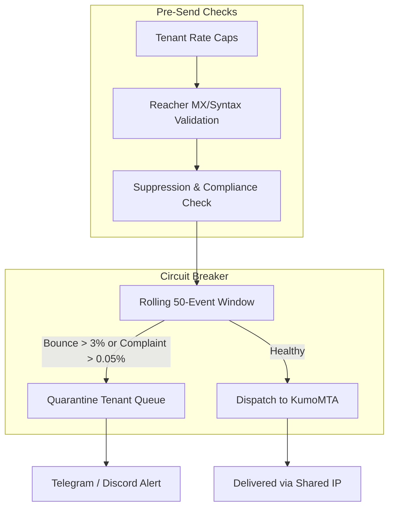

# SLIDEIN COMPLIANCE & RISK REGISTER

> **Authority Document on Licensing, Deliverability Protection, and Cold Email Law**  
> Status: Active Operational Policy  
> Date: 2026-10-16  
> Author: Nasrullah Tanim

---

## 1. Licensing & Competitive Protection (BSL 1.1)

### Choice: Business Source License 1.1 vs AGPLv3
- **Decision:** SlideIn adopts the **Business Source License 1.1 (BSL 1.1)** with an automatic conversion to Apache 2.0 after 4 years (October 16, 2030).
- **Rationale against AGPLv3:** While AGPLv3 enforces copyleft over the network, competitors can legally package, re-brand, and resell SlideIn as a commercial multi-tenant cloud service so long as they offer source code downloads. This directly threatens the $350/mo managed cloud business model.
- **BSL 1.1 Advantage:**
  1. **Free for Self-Hosting:** Single organizations are granted full permission to self-host, audit, modify, and run SlideIn internally on their own VPS or servers without paying license fees.
  2. **Competitor Cloud Bar:** Third parties are strictly prohibited from reselling or offering SlideIn as a managed SaaS, hosted platform, or commercial multi-tenant service.
  3. **Eventual Open Source:** After 4 years, code converts to Apache 2.0, giving community long-term guarantees.

### Clean-Room Provenance & Non-Infringement Standard
- **Zero-Tolerance Rule:** SlideIn is built 100% clean-room.
- **OpenOutreach Isolation:** Under NO circumstances may any code, prompt templates, database schemas, or routing logic be copied or adapted from OpenOutreach (licensed under GPLv3) or any other third-party GPL project.
- **Verification:** All models, migrations, endpoints, and algorithms are independently designed and authored for SlideIn.

---

## 2. Deliverability Liability & Shared IP Isolation

### The Multi-Tenant Risk on Shared VPS (`169.58.206.20`)
When multiple client tenants share outgoing IPs through KumoMTA, a single bad actor or low-quality recipient list uploaded by Tenant A can cause high hard-bounces and spam complaints. This damages the reputation of the shared IP and harms delivery rates for Tenant B and Tenant C.

### Mitigation Architecture

1. **Per-Tenant Quotas & Rate Caps:**
   - **Hourly Limit:** 10 to 20 emails/hour per tenant (customizable up to 50/hour once warmed).
   - **Daily Limit:** 50/day during initial warmup stage, scaling to maximum 200/day standard.
   - **Concurrent Connections:** Limited per tenant to prevent spool starvation.
2. **Automated Tenant Abuse Quarantine (Circuit Breaker):**
   - The system tracks a rolling window of 50-100 dispatches per tenant.
   - **Trip Thresholds:**
     - Hard Bounce Rate $> 3.0\%$ OR
     - Spam Complaint Rate $> 0.05\%$
   - **Action upon trip:** The specific offending tenant's queue is immediately moved to `QUARANTINED_ABUSE_REVIEW`. All scheduled dispatches for that tenant are frozen.
   - **Isolation Guarantee:** Neighboring tenants continue sending without disruption.
   - **Operator Alert:** Instant notification dispatched to Telegram / Discord for human review.
3. **Mandatory Pre-Send Reacher Verification:**
   - Unverified leads cannot be submitted to the SMTP transport. Addresses marked `invalid` by Reacher (:8090) are rejected prior to transmission.

---

## 3. Cold-Email Law Compliance (CAN-SPAM, GDPR, CASL, UK PECR)

Every outbound email produced or sent by SlideIn must strictly adhere to statutory requirements across jurisdictions:

| Requirement | Statutory Basis | System Enforcement Mechanism |
|---|---|---|
| **Lawful Basis** | GDPR Art. 6(1)(f), PECR Reg 22 | B2B legitimate interest assessment required; target role and business context must be documented prior to campaign launch. |
| **Clear Opt-Out** | CAN-SPAM § 7704(a)(3), GDPR Art. 21 | Mandatory plain-text opt-out footer in every email (`"Reply 'stop' or 'unsubscribe' to opt out"`). Automatic RFC 8058 `List-Unsubscribe` headers. |
| **Instant Suppression** | CAN-SPAM (10-day rule), GDPR (immediate) | Immediate zero-delay insertion into `suppression_records`. Any inbound reply classified as `unsubscribe` permanently blocks future sends. |
| **Physical Address** | CAN-SPAM § 7704(a)(5)(A)(iii) | Tenant **must** have a registered physical postal address in workspace settings. System throws `MissingPhysicalAddressError` and blocks send if missing. |
| **Non-Deceptive Headers** | CAN-SPAM § 7704(a)(1) | Sender display name, `From`, and `Reply-To` must truthfully reflect the verified sending domain. No header forgery. |

---

## 4. Implementation Invariants in `slidein-api`

1. `DeliverabilityGuard` service in `slidein_api/services/deliverability_guard.py` enforces:
   - Tenant quarantine state checks
   - Rolling bounce and complaint rate calculations
   - Physical postal address requirement check
   - Opt-out footer injection and RFC 8058 header attachment
2. `OutreachService` hooks directly into `DeliverabilityGuard` prior to SMTP dispatch.
