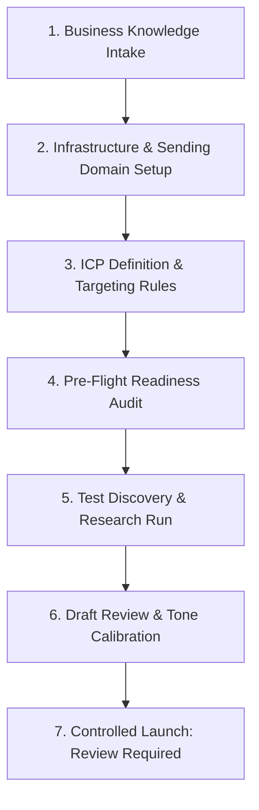

# SLIDEIN CLIENT DEPLOYMENT RUNBOOK

> **Standard Operating Procedure for Onboarding & Operating a New Client Business**  
> Status: Authoritative Runbook  
> Version: 1.0.0

---

## 1. Onboarding Timeline & Checklist

---

## 2. Step-by-Step Procedure

### Step 1: Business Knowledge Intake
1. Create client tenant in console: `POST /api/tenants` with client slug and plan tier.
2. Complete the Business Identity profile: Legal name, website, value proposition, ICP summary.
3. Register at least 1 active business offer: Name, problem solved, target persona, proof points.
4. Input evidence proof points (case studies, verified customer metrics).

### Step 2: Infrastructure & Sending Domain Setup
1. Assign or provision dedicated sending domain (e.g., `acme-outreach.com`).
2. Add DNS records:
   - SPF: `v=spf1 ip4:169.58.207.75 ~all`
   - DKIM: `kumo._domainkey` 2048-bit public key
   - DMARC: `v=DMARC1; p=reject; rua=mailto:dmarc@...`
   - MX: Points to Mailcow VPS
3. Run verification: `python3 deliverability/precheck.py --domain acme-outreach.com`.
4. Configure SMTP submission credentials in KumoMTA policy.

### Step 3: ICP Definition & Exclusions
1. Configure ICP: Industry filters, company size range ($20-500$), target titles (VP, Director, Head).
2. Configure exclusions: Competitor domains, current customer blacklist, geographic restrictions.

### Step 4: Run Pre-Flight Readiness Audit
1. Navigate to `/knowledge/readiness` or invoke `GET /api/tenants/{id}/readiness`.
2. Ensure overall readiness score is $\ge 90\%$. All critical security, suppression, and DNS gates must be green.

### Step 5: Test Discovery & Draft Calibration
1. Ingest batch of 15 candidate prospects.
2. Trigger automated research worker; inspect generated `evidence_items`.
3. Generate personalized drafts; review with client stakeholder for voice and tone approval.

### Step 6: Activation (Autonomy Level 1)
1. Set tenant autonomy level to **Level 1 (Review Required)**.
2. Activate initial daily sending volume cap ($15/\text{day}$ per sending mailbox).
3. Monitor daily metrics: Delivery rate ($> 98\%$), bounce rate ($< 1.5\%$), reply classification.
