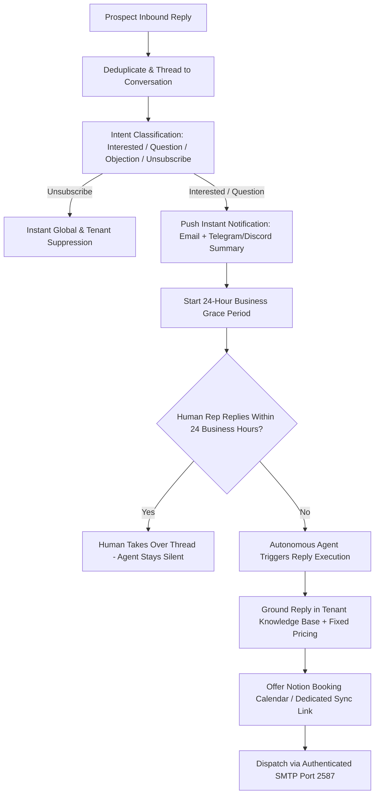

# SLIDEIN — CLIENT COMMUNICATIONS REGISTER & STANDARDS

> **Document Class:** Authoritative Communication Protocols & Outreach Standards  
> **Target Audience:** Client Operators, Autonomous Agents, Integration Engineers  
> **Version:** 1.0.0  
> **Date:** 2026-10-16  

---

## 1. Outreach Communication Philosophy

All outbound correspondence generated by SlideIn follows the **1:1 Peer-to-Peer Architectural Standard**:
1. **Plain-Text First:** Messages are rendered as pure text without multi-column HTML formatting, commercial header images, or button wrappers.
2. **First-Touch Link Prohibition:** **STRICTLY ZERO links** in initial cold outreach emails. Links severely depress primary inbox placement and trigger automated spam filters.
3. **Evidence-Grounded Personalization:** Every claim or reference must cite an evidence item from the prospect research dossier.
4. **Focused Call to Action:** A single, low-friction conversational ask (e.g. *"Open to taking a look at how this compares?"*), not an aggressive meeting demand.

---

## 2. Inbound Reply & Grace Period Protocol

When a prospect replies to an outreach message:



### 2.1 The 24-Hour Business Grace Period Window
- **Clock Definition:** 24 active business hours from the moment an inbound reply is ingested.
- **Excluded Windows:** Weekends (Saturday & Sunday) and official US Federal Holidays are paused and do not count toward the 24-hour limit.
- **Human Takeover:** If a human team member responds directly or marks the thread as `Under Review`, the autonomous timer is cancelled and the agent remains silent.
- **Autonomous Execution:** If 24 business hours expire without a human response, the agent drafts and dispatches the response using the tenant's approved knowledge base.

---

## 3. Real-Time Notification Templates

SlideIn pushes real-time alerts to the operator's integrated messengers (Discord, Telegram, Slack, or Email).

### 3.1 Telegram / Discord Alert Payload Example
```markdown
🔔 [SLIDEIN RADAR] New Interested Reply Received!

• Prospect: Sarah Jenkins (VP Engineering at FinTech Labs)
• Company: FinTech Labs (fintechlabs.io)
• Campaign: B2B Enterprise Q4 Outbound
• Detected Intent: INTERESTED / MEETING_REQUEST (Confidence: 96%)
• Prospect Message: 
  "Thanks for reaching out, Nasrullah. Your point about deliverability resonates. What does pricing look like, and how does setup work?"

⏱ 24-Hour Human Grace Period Active:
• Autonomous Agent scheduled to respond in: 23h 58m (US Business Time)
• Action Required: Reply manually in your Gmail/Outlook/Dashboard, or let SlideIn respond.
```

---

## 4. Non-Negotiable Pricing Policy

1. **Fixed Monthly Rates:** Client pricing is set by the client admin in the knowledge base (e.g., $350/mo or custom subscription).
2. **Zero Negotiation Discretion:** Autonomous agents are strictly instruction-locked:
   - They **CANNOT** offer discounts, coupon codes, custom billing terms, or trial extensions.
   - Any pricing inquiries must state the approved fixed monthly price clearly and direct the prospect to a booked call if custom enterprise requirements exist.
