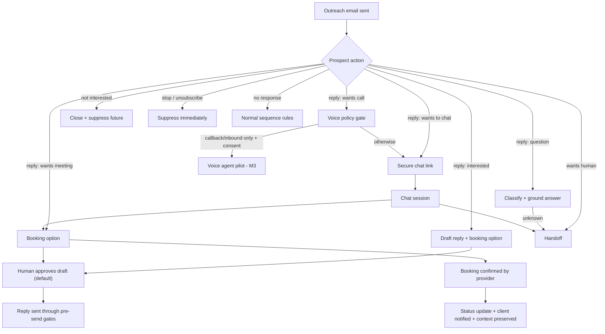

# SLIDEIN PROSPECT ENGAGEMENT, CONVERSATIONAL AGENTS & DIRECT MEETING BOOKING

> **Capability Specification** — extends Module 6 (Conversations) of
> [`PRODUCT_SPECIFICATION.md`](PRODUCT_SPECIFICATION.md) and Phase 10 of
> [`../engineering/IMPLEMENTATION_ROADMAP.md`](../engineering/IMPLEMENTATION_ROADMAP.md).
> Status: **Investigated, documented, NOT built.** Version 0.1.0 (2026-10-16).
> Architecture: [`../architecture/ENGAGEMENT_ARCHITECTURE.md`](../architecture/ENGAGEMENT_ARCHITECTURE.md).
> Open questions: [`../project/OPEN_QUESTIONS.md`](../project/OPEN_QUESTIONS.md).
> Implementation status lives only in [`../project/CURRENT_STATE.md`](../project/CURRENT_STATE.md).

---

## 0. How to read this document (evidence labels)

Every requirement carries a **source label** and a **status label**. Never treat a
`PROPOSED` or `RESEARCH` item as approved.

| Source label | Meaning |
|---|---|
| `OV` | Owner's stated product vision (Nasrullah Tanim, request of 2026-10-16). Not a client statement. |
| `WS` | Owner workspace planning/research notes in `workspace-app/Notepad Export/` and `project/Notepad Export/` (see §1). Recorded planning, **not client-signed**. |
| `DOC` | Existing authoritative repo documentation. |
| `CODE` | Existing code in the repository (verified by reading it). |
| `REC` | Recommendation made by this analysis. |

| Status label | Meaning |
|---|---|
| `OWNER-CONFIRMED` | Stated by the owner as product direction. |
| `PLANNED` | Recorded in owner planning notes; needs client/owner confirmation before commitment. |
| `PROPOSED` | Recommendation awaiting owner approval. |
| `RESEARCH` | Technical feasibility must be investigated before any commitment. |
| `BLOCKED` | Must not be built until a named decision/legal review is made. |

**No client has stated any requirement in the sources available to this work.** See §1.2.

---

## 1. Source register & investigation findings

### 1.1 Sources actually reviewed

| ID | Source | Path | Relevance |
|---|---|---|---|
| S-01 | Product vision | `SLIDEIN_PRODUCT_VISION.md` | North star, prospect-to-conversation workflow |
| S-02 | Product specification | `docs/product/PRODUCT_SPECIFICATION.md` | Module 6 reply management, autonomy levels |
| S-03 | User journeys | `docs/product/USER_JOURNEYS.md` | Journey 4 inbound/meeting stub |
| S-04 | Implementation roadmap | `docs/engineering/IMPLEMENTATION_ROADMAP.md` | Phase 10 "Inbound Conversations & Outcomes" |
| S-05 | Current state | `docs/project/CURRENT_STATE.md` | Row 23: receiving/IMAP **not implemented**; replies go nowhere |
| S-06 | Integrations, data model, lifecycle, security, tenant memory | `docs/architecture/*.md` | Boundaries this capability must respect |
| S-07 | Limitations | `docs/operations/PRODUCT_LIMITATIONS.md` | No unapproved sending; rate limits |
| S-08 | Existing backend | `slidein-api/slidein_api/services/conversations.py`, `models.py` (`Conversation`, `InboundReply`), `api/routes/outreach.py` (`POST /webhooks/inbound`) | Reply ingest, threading, intent classification, opt-out suppression **already exist** |
| S-09 | Plan | `workspace-app/Notepad Export/The Plan.md` | Correction 4 (TCPA: AI voice is an "artificial voice"; inbound/callback only), Part 5 (chatbot has one job: qualify and book; disclose AI), Part 8 (booking layer wired to same calendar) |
| S-10 | Appointment Loop | `workspace-app/Notepad Export/The 100-Appointment Loop.md` | Phase 10 (chatbot, AI disclosure, human escalation, inbound/callback-only voice, call summary log), Phase 12 (pre-call brief), Phase 14 (booking link, reminders, reschedule, qualify-before-book gate) |
| S-11 | Deliverables | `Client Deliverables.md`, `100 Client Deliverables.md`, `Items I will provide.md` | Chatbot answers only from approved knowledge base; voice "only if the client wants it"; consent documentation for voice/SMS |
| S-12 | Chatbot/voice research | `project/Notepad Export/Research - AI Chatbot and Voice Receptionist.md` (duplicate under `workspace-app/Notepad Export/`) | Buy-vs-build, vendor landscape, disclosure laws, cost. **Vendor-sourced; unaudited.** |
| S-13 | Brand/design | `../sv to tanim.social/design-system.md` + `app/styles/*.css`; `workspace-app/app/styles/*.css`; `/design.md` | See §10 |
| S-14 | Agent instructions | `AGENTS.md`, `PROJECT_POLICY.md`, `CLAUDE.md` | Working rules |

### 1.2 Foundational Project Assets Created (2026-10-16)

Per owner directive, the canonical foundational materials have been created to ground future agents:
- **Executive Delivery Report:** [`docs/operations/EXECUTIVE_DELIVERY_REPORT.md`](../operations/EXECUTIVE_DELIVERY_REPORT.md).
- **Client Communications Register:** [`docs/product/CLIENT_COMMUNICATIONS_REGISTER.md`](CLIENT_COMMUNICATIONS_REGISTER.md) (1:1 plain-text standard, 24-hr grace period, alert payloads).
- **Updated Brand Kit:** [`docs/design/UPDATED_BRAND_KIT.md`](../design/UPDATED_BRAND_KIT.md) (Live-text wordmark, OKLCH brand orange hue 42.28, Fraunces display typography, blueprint primitives).

### 1.3 Confirmed Operational Decisions & Architecture (Owner Confirmed 2026-10-16)

1. **Dual Inbound Path (Approved):**
   - *Path A (KumoMTA Outbound/Inbound):* Built-in open-source webmail viewer rendered directly in the dashboard.
   - *Path B (External Mailbox Sync):* Native Google Workspace & Microsoft 365 OAuth/IMAP sync so replies land directly in the client's Gmail/Outlook.
2. **24/7 Background Notification Telemetry (Approved):** Real-time alerts and executive summaries dispatched to **Telegram Bot**, **Discord Webhook**, and **Slack Webhook** in addition to email.
3. **Primary Calendar Integration (Approved):** **Notion Booking Calendar** is the primary default, with dedicated booking link sync (Cal.com, Calendly, or custom URL).
4. **24-Hour Business Grace Period (Approved):** The client has 24 business hours (excluding US weekends and federal holidays) to reply manually. If no manual intervention occurs, the autonomous agent sends a hyper-relevant response grounded in the knowledge base.
5. **Zero First-Touch Links (Approved):** Strictly NO links in initial cold outreach emails. Links are provided only in later stages when the prospect expresses interest.
6. **Non-Negotiable Fixed Pricing (Approved):** Client sets fixed monthly pricing in the knowledge base; agents have zero authority to discount or negotiate.

---

## 2. Product vision extension

**Existing:** Discover → Research → Qualify → Personalize → Dispatch → Conversations.
**Extended (`OV`, `OWNER-CONFIRMED` as direction):**

```
Prospect discovery → Personalized outreach → Prospect engagement
   → AI-assisted conversation → Qualification (where appropriate)
   → Meeting booking → Client handoff and follow-up
```

**Business objective (`OV`):** reduce friction between receiving an outreach email and having a
meaningful conversation with the client. **How it supports it:** a reply, question or "tell me more" never
dead-ends; the prospect is answered accurately, offered the next step, and a real meeting lands on the
client's calendar with context preserved.

**Boundaries kept from the vision (`DOC`/`OV`):** grounded in approved client information; no invented
facts; human control; tenant isolation; honest about limits. It is **not** a generic chatbot or aggressive
sales script (`OV`).

---

## 3. Capability: Prospect Engagement (C-ENG)

### 3.1 Sub-features

| ID | Feature | Description |
|---|---|---|
| F-RPL | Conversational email replies | Receive, associate, understand and answer replies in the email thread |
| F-CHT | Chat agent | Hosted, tenant-branded chat reached from a secure personalized link |
| F-VCE | Voice agent | Inbound / callback-only voice; outbound calling is a separate, blocked decision |
| F-BKG | Direct meeting booking | Offer, create, confirm, change and cancel meetings via an approved integration |
| F-KNW | Approved knowledge & grounding | Tenant-scoped, approved, versioned information the agents may use |
| F-HND | Human handoff & notifications | Take over, see full context, be alerted |
| F-CMP | Consent, opt-out, security & audit | Suppression, consent records, secure links, logs, kill switch |

### 3.2 User roles

| Role | Needs |
|---|---|
| **Prospect** | Answers without friction, an obvious way to a human, easy stop, no account required |
| **Client representative** | Notified fast, full context, can take over, sees booked meetings |
| **Client admin** | Maintains approved knowledge, sets approval mode, meeting types, representatives |
| **Platform operator** | Monitors health, kill switches, provider status, cross-tenant ops (no customer content) |

### 3.3 Dependencies

Receiving mail path (S-05 #23) → thread stitching (exists) → knowledge base (new) → approval enforcement
(S-05 #22) → booking provider decision (open) → [chat hosting + branded pages] → [voice provider + legal review].

### 3.4 Scope & Release Cadence (Owner Approved 2026-10-16)

| Milestone | Scope & Deliverables | Status | Rationale |
|---|---|---|---|
| **M1 "Reply-to-Meeting Loop" (MVP Core)** | Inbound reply ingest (Dual path: KumoMTA webmail / Google & M365 sync) → thread to prospect/campaign → 24-hr human grace period (excluding US non-working days) with instant Email + Telegram/Discord alert → grounded agent draft from knowledge base → Notion Booking Calendar (or dedicated link sync) → booking confirmed → client notification → strict opt-out suppression. | **APPROVED by Owner** | Delivers the full end-to-end vision over 1:1 email, prevents spam penalties by keeping first touch link-free, and automates conversion. |
| **M2 Hosted Chat Agent** | Secure personalized link delivered upon interest → hosted tenant-branded chat page → clear AI disclosure → qualification → direct Notion booking → live representative handoff. | **PLANNED** | Builds directly upon M1 knowledge base and Notion scheduling provider. |
| **M3 Inbound Voice Add-On** | Inbound/callback-only voice receptionist (Retell AI / Synthflow) → call transcription → summary log → automated meeting booking. Strictly no unsolicited outbound calls. | **PLANNED (Opt-in Add-on)** | High-touch value add; conditional on jurisdiction disclosure compliance and client activation. |
| **BLOCKED** | Proactive automated outbound calls or unsolicited SMS to cold prospects. | **BLOCKED** | Barred under TCPA / regulatory risk without prior express written consent. |

---

## 4. Functional requirements

IDs are stable; never renumber. `Task` links to §9 / the roadmap table. `AC` = acceptance criterion
(verification detail in task table).

### 4.1 Reply handling (F-RPL)

| ID | Requirement | Flow | Task | AC | Src/Status |
|---|---|---|---|---|---|
| ENG-REQ-001 | The system SHALL receive replies to outreach emails sent from tenant sending identities through a production inbound path | FL-01 | T-001 | A real reply to a sent message appears in the conversation within 60 s | OV / PROPOSED (path undecided) |
| ENG-REQ-002 | Each inbound message SHALL be processed exactly once (dedupe by Message-ID) | all | T-002 | Replaying the same MIME 5× creates 1 record | REC / PROPOSED |
| ENG-REQ-003 | A reply SHALL be associated with the correct tenant, prospect, campaign, draft and conversation using `In-Reply-To`/`References` with a documented fallback | FL-01 | T-003 | 20/20 fixture replies map correctly incl. forwarded/changed-subject cases; ambiguous → human review queue | CODE+OV / PROPOSED |
| ENG-REQ-004 | Auto-replies, out-of-office, bounces/DSNs and mailing-list loops SHALL NOT trigger agent responses | FL-01 | T-004 | OOO fixture creates record, zero outbound reply; agent never replies to itself | REC / PROPOSED |
| ENG-REQ-005 | Each reply SHALL be classified with intent and confidence; low confidence SHALL route to a human | FL-02..08 | T-013 | Confidence < threshold ⇒ human queue | CODE+DOC / PLANNED |
| ENG-REQ-006 | An unsubscribe/stop request SHALL suppress the prospect and cancel all pending sends and agent activity before any further message | FL-07 | T-005 | After stop reply: zero further sends in an automated test incl. pending queue and agent drafts | DOC+CODE / PLANNED |
| ENG-REQ-007 | Agent-authored email replies SHALL default to **human approval before sending**; auto-send only for allow-listed intents at autonomy Level ≥ 2 | FL-02..05 | T-013/14 | Level-1 tenant: no agent email sent without approval event | DOC+REC / PROPOSED |
| ENG-REQ-008 | Agent replies SHALL pass the same pre-send gates as outreach (suppression, circuit breaker, rate limits, approved identity) | all | T-014 | Tripped breaker blocks agent reply | DOC / PLANNED |
| ENG-REQ-009 | Replies SHALL answer only from approved knowledge and cite the knowledge items used | FL-02 | T-011 | 100% of factual statements in test set traceable to an approved item or flagged | OV / PROPOSED |
| ENG-REQ-010 | The full email thread and every agent/human action SHALL be preserved and visible in one conversation view | FL-01 | T-006/024 | Conversation shows ordered messages with author type | OV / PROPOSED |

### 4.2 Chat agent (F-CHT)

| ID | Requirement | Flow | Task | AC | Src/Status |
|---|---|---|---|---|---|
| ENG-REQ-020 | A prospect SHALL be able to start a chat via a personalized secure link without creating an account | FL-04 | T-007/025 | Link opens a session bound to prospect+campaign+tenant | OV / PROPOSED |
| ENG-REQ-021 | Links SHALL use unguessable (≥128-bit) single-prospect tokens, stored hashed, with expiry and revocation; no personal data in the URL | FL-04 | T-007/035 | Tampered/expired/revoked token → generic denial, no data leak | REC / PROPOSED |
| ENG-REQ-022 | The chat SHALL disclose at the first message that it is an AI assistant | FL-04 | T-026/027 | First message contains disclosure in 100% of sessions | WS (S-09, S-12) / PLANNED — legal review needed |
| ENG-REQ-023 | The chat SHALL answer only from approved knowledge and decline or escalate otherwise | FL-09 | T-011/027 | Out-of-scope prompt set: 0 fabricated facts | OV+WS / PLANNED |
| ENG-REQ-024 | The chat SHALL have one primary job: help the prospect take the next step (qualify and book), escalating the rest | FL-03/05 | T-027/028 | Scripted scenarios reach booking or handoff | WS (S-09 Hick's Law) / PLANNED |
| ENG-REQ-025 | A human handoff control SHALL be visible in every session | FL-08 | T-022/026 | Request-human control present and functional | OV / PROPOSED |
| ENG-REQ-026 | Chat sessions SHALL be recorded and attached to the prospect conversation | all | T-006 | Transcript appears in conversation view | OV / PROPOSED |
| ENG-REQ-027 | Qualification questions SHALL be asked only when appropriate and SHALL NOT block a prospect who just wants a meeting | FL-03 | T-028 | Meeting-intent scenario books without a questionnaire | OV / PROPOSED |
| ENG-REQ-028 | Abandoned sessions SHALL follow a tenant-configured, consent-respecting follow-up policy (default: no automated follow-up beyond one email reminder if consent allows) | FL-11 | T-030 | Abandon fixture yields at most the configured follow-up | REC / PROPOSED |

### 4.3 Voice (F-VCE)

| ID | Requirement | Flow | Task | AC | Src/Status |
|---|---|---|---|---|---|
| ENG-REQ-040 | The system SHALL NOT place automated/AI outbound calls or send automated texts to prospects | – | T-031 | Code path absent / disabled and tested | WS (S-09 C4) / BLOCKED pending legal review & approval |
| ENG-REQ-041 | Voice SHALL be limited to inbound calls and callbacks to people who called in or gave explicit written opt-in | FL-06 | T-032 | Voice agent cannot originate to non-consented number | WS / PLANNED |
| ENG-REQ-042 | The voice agent SHALL identify itself as AI in its greeting | FL-06 | T-032 | Greeting transcript check | WS / PLANNED |
| ENG-REQ-043 | Voice SHALL be an opt-in add-on per tenant, with a chat-only fallback | FL-06 | T-032 | Tenant without voice flag has no voice route | WS (S-11) / PLANNED |
| ENG-REQ-044 | Call summary, outcome and (if recorded) transcript SHALL be attached to the prospect record under a documented retention/consent policy | FL-06 | T-033 | Record exists; recording only when consent captured | WS / RESEARCH |
| ENG-REQ-045 | The voice agent SHALL transfer to a human on request or low confidence | FL-08 | T-032 | Transfer path tested | OV / RESEARCH |

### 4.4 Meeting booking (F-BKG)

| ID | Requirement | Flow | Task | AC | Src/Status |
|---|---|---|---|---|---|
| ENG-REQ-060 | The system SHALL offer a way to book a meeting with the appropriate representative/meeting type | FL-03/05 | T-016/017 | Interested reply produces approved draft with booking option | OV / PROPOSED |
| ENG-REQ-061 | M1 SHALL use a scheduling link from an approved provider; direct agent booking via API is an M2 option | FL-03 | T-017/018 | Link works; booking confirmed event received | REC / PROPOSED (provider open) |
| ENG-REQ-062 | Time zones SHALL be handled explicitly (prospect and rep shown in own zone) | FL-03 | T-017/018 | DST-boundary test passes | OV / PROPOSED |
| ENG-REQ-063 | Double bookings and calendar conflicts SHALL be prevented; booking creation SHALL be idempotent | FL-10 | T-018/019 | Concurrent duplicate requests → 1 meeting | OV / PROPOSED |
| ENG-REQ-064 | A confirmed booking SHALL update prospect/campaign status, record source and conversation context, and notify the client | FL-03 | T-019/023 | Status = MEETING_BOOKED; notification delivered | OV / PROPOSED |
| ENG-REQ-065 | Reschedule and cancellation SHALL be supported and reflected in records | FL-10 | T-020 | Reschedule/cancel events update meeting + notify | OV / PROPOSED |
| ENG-REQ-066 | If availability is unavailable or changes, the prospect SHALL be told honestly and offered a human fallback | FL-10 | T-018/022 | Simulated provider outage → fallback message, no false confirmation | OV / PROPOSED |
| ENG-REQ-067 | The agent SHALL NOT state a meeting is booked until the provider confirms | FL-03 | T-019 | No confirmation text before confirmation event | REC / PROPOSED |
| ENG-REQ-068 | Qualification fields captured before booking SHALL be tenant-configurable and logged per meeting | FL-03 | T-028 | Fields stored with meeting | WS (S-09 Part 7) / PLANNED |
| ENG-REQ-069 | Reminder and pre-call brief behaviour is deferred to Phase 12/14 design | – | T-021 | – | WS / PLANNED (later) |

### 4.5 Knowledge & behavior (F-KNW)

| ID | Requirement | Task | AC | Src/Status |
|---|---|---|---|---|
| ENG-REQ-080 | Agents SHALL use only tenant-approved knowledge; each item has class, version, approver, effective/expiry date | T-009 | Unapproved item never retrieved | OV+DOC / PROPOSED |
| ENG-REQ-081 | Prices, availability, commitments and business facts SHALL NOT be invented; unknown ⇒ say so and escalate | T-011/012 | Adversarial eval set | OV / PROPOSED |
| ENG-REQ-082 | Information SHALL be labelled `verified_client`, `prospect_provided`, `agent_inferred` or `unconfirmed_review` and never blended in output | T-009/011 | Label present in stored messages | OV / PROPOSED |
| ENG-REQ-083 | Missing, contradictory or expired knowledge SHALL block answering that topic and notify the admin | T-011 | Expired item test | OV / PROPOSED |
| ENG-REQ-084 | Knowledge SHALL be strictly tenant-isolated (no cross-tenant retrieval) | T-009/011 | Boundary tests extended | DOC / PLANNED |
| ENG-REQ-085 | Approved pricing is shared only if explicitly approved for external sharing | T-009 | Unapproved-pricing prompt test | OV / PROPOSED |

### 4.6 Handoff, security, ops

| ID | Requirement | Task | AC | Src/Status |
|---|---|---|---|---|
| ENG-REQ-100 | A representative SHALL be able to take over any conversation; the agent stops responding while a human owns it | T-022 | Agent silent after takeover | OV / PROPOSED |
| ENG-REQ-101 | Takeover SHALL show full history, evidence, agent actions and what was promised | T-024 | Context view complete | OV / PROPOSED |
| ENG-REQ-102 | Representatives SHALL be notified of: interest, booking, handoff request, unanswered question | T-023 | Notification test per event | OV / PROPOSED |
| ENG-REQ-110 | A per-tenant and global **emergency stop** SHALL halt all agent sending/answering immediately | T-037 | Stop drops queue, blocks send | OV / PROPOSED |
| ENG-REQ-111 | Every agent decision, message, approval, booking, suppression and handoff SHALL be written to an append-only audit log | T-008 | Audit entry per action | OV+DOC / PROPOSED |
| ENG-REQ-112 | Events SHALL be processed reliably: idempotent, retried with backoff, dead-lettered, recoverable | T-002/039 | Fault-injection test | OV / PROPOSED |
| ENG-REQ-113 | Consent and communication preferences SHALL be recorded per prospect/channel with source and time | T-034 | Consent record per channel | OV / PROPOSED |
| ENG-REQ-114 | Calendar access SHALL use least-privilege, tenant-scoped authorization with revocation | T-016 | Scope review | OV / PROPOSED |
| ENG-REQ-115 | Retention and deletion for conversations, recordings and transcripts SHALL be defined and enforceable | T-036 | Deletion test | OV / RESEARCH (legal) |
| ENG-REQ-116 | Conversation data SHALL be `tenant_private`; only anonymized, reviewed signals may be promoted per the tenant memory policy | T-009 | Policy test | DOC / PLANNED |
| ENG-REQ-117 | No claim of regulatory compliance SHALL be made; legal review checklist maintained | T-038 | Checklist signed off | OV / PROPOSED |

---

## 5. End-to-end interaction design

### 5.1 Overview



### 5.2 Branch specifications

Components: **IG** inbound gateway, **TR** thread resolver, **IC** intent classifier, **KS** knowledge service,
**RA** reply agent, **CA** chat agent, **BS** booking service, **NS** notification service, **PE** policy engine,
**SUP** suppression service. (See architecture doc.)

| ID | Branch | 1 Trigger | 2 System action | 3 Responsible | 4 Prospect experiences | 5 Data/status updated | 6 Next | 7 Tests |
|---|---|---|---|---|---|---|---|---|
| FL-01 | Reply received (any) | Inbound MIME arrives | Dedupe, stitch to prospect/campaign, filter auto-replies, classify | IG, TR, IC | Nothing visible yet | `inbound_message` row, conversation updated, audit | Branch by intent | Replay/dedupe, threading fixtures, OOO |
| FL-02 | Question | Intent `information_request` | Retrieve approved knowledge; draft grounded answer; approval gate | KS, RA, PE | A clear, honest answer in-thread (after approval at Level 1) | draft + citations stored; status `ENGAGING` | Await reply | Grounding, no-fabrication set |
| FL-03 | Interested / asks for meeting | `interested` or explicit meeting ask | Draft reply with booking option; ask minimal qualification only if configured | RA, BS | Reply with scheduling choice | status `MEETING_PROPOSED`; notify rep | Booking or chase policy | Link works; qualify gate; tz |
| FL-04 | Wants to chat first | Reply asks chat or policy offers chat | Mint secure link; include in approved reply | RA, session service | Click link → AI-disclosed chat | `engagement_session` created, token hashed | Chat → FL-03/08/09 | Token security, disclosure |
| FL-05 | Booking from chat/email | Prospect picks time | Create/confirm booking idempotently | BS | Confirmation only after provider confirms | `meeting` row, status `MEETING_BOOKED`, notify | Reminders (later) | Idempotency, conflicts |
| FL-06 | Voice requested | Reply asks to talk | Policy gate: offer inbound number/callback request with consent; else chat/human | PE, voice gateway (M3) | Inbound number or callback request form | consent record; call record later | Call → summary, booking or human | No outbound without consent; disclosure |
| FL-07 | Stop / unsubscribe | Intent `unsubscribe` or header | Suppress, cancel pending, confirm if policy allows | SUP | No further email | suppression record, prospect `OPTED_OUT`, audit | Terminal | All pending cancelled |
| FL-08 | Needs human | Request, low confidence, sensitive topic | Pause agent, notify rep with context | PE, NS | "A person will follow up" (honest) | conversation `HUMAN_OWNED` | Human replies | Agent silent after takeover |
| FL-09 | Agent cannot answer | No approved knowledge | Do not guess; escalate; optionally acknowledge | KS, RA | Honest "I'll check and come back" | `unanswered_question` flagged, admin notified | Human answers; KB updated | Out-of-scope prompts |
| FL-10 | Availability unavailable/changes | Provider error, slot taken, reschedule | Retry; fallback to human/alternate times; never false-confirm | BS | New options or human follow-up | meeting updated/failed, audit | Rebook/handoff | Outage, race, DST |
| FL-11 | Abandoned | Session/thread idle past tenant window | Apply tenant policy (default minimal) | PE | At most one allowed reminder | status `STALLED` | Sequence rules | Idle fixture |
| FL-12 | Not interested | Intent `not_interested` | Close politely or stay silent per tenant policy; suppress sequence | RA, SUP | Optional courteous close | status closed | Terminal | Sequence cancelled |

### 5.3 Email limitations (documented, not hidden)

- Ordinary email clients **cannot** host an interactive chat or live call. Anything beyond text needs a **link** (chat/booking page) or another channel.
- Links raise deliverability risk in cold mail; therefore links are offered **in replies to engaged prospects** (`REC`); first-touch policy is OQ-007.
- Reply addresses require a working inbound path (S-05 #23).
- Email threads can fork (forwards, cc's, new subjects): threading must tolerate this and route ambiguity to a human.
- Open/click tracking is unreliable (privacy proxies) and must not be used as consent or intent signal.

---

## 6. Agent knowledge & behavioral boundaries

### 6.1 Knowledge sources (all tenant-scoped; see `TENANT_MEMORY_POLICY.md`)

Business profile; approved offers/services; ICP and qualification criteria; approved pricing (only if flagged shareable);
FAQs; representative and meeting-type definitions; approved tone/brand rules; relevant prospect/outreach context
(evidence items from research); escalation procedures.

### 6.2 Information classes (never blended)

| Class | Meaning | May be stated as fact to prospect? |
|---|---|---|
| `verified_client` | Approved by client admin, versioned, unexpired | Yes, with citation |
| `prospect_provided` | What the prospect said | Yes, attributed ("you mentioned…") |
| `agent_inferred` | Agent interpretation | No — internal only, flagged |
| `unconfirmed_review` | Needs human review | No — triggers escalation |

Maps onto existing `evidence_items.verification_status` (`verified` / `inferred` / `unverified`).

### 6.3 Rules

1. Never invent prices, availability, commitments, guarantees or business facts.
2. Missing/contradictory/outdated/unapproved information ⇒ do not answer that point; escalate (FL-09).
3. First chat/voice message identifies as AI (ENG-REQ-022/042). Legal review pending.
4. One primary job: move the prospect to the next step; escalate everything else (`WS` S-09).
5. Tone/brand rules come from the tenant brand configuration; the platform default follows §10.
6. Maintenance: client admin edits → approval → version; expiry dates; change log; unanswered questions feed a review queue. Cross-tenant sharing only via the tenant memory policy's promotion process.

### 6.4 Human handoff behavior

Representative can take over from the conversation view; agent pauses; representative sees thread, evidence,
agent drafts, citations, commitments made, qualification answers and meeting state; can hand back to the agent.

---

## 7. Privacy, security, deliverability, reliability (investigation notes)

These are **engineering requirements and open legal questions, not compliance claims.**

| Area | Requirement / question |
|---|---|
| Identity & association | Token/thread binding to tenant+prospect+campaign (ENG-REQ-003/021) |
| Isolation | All new tables carry `tenant_id`; extend boundary tests |
| Consent & preferences | Per-channel consent records (ENG-REQ-113); email consent regime vs phone/SMS regime differ (`WS` S-09 C4) |
| Opt-out | Immediate suppression incl. in-flight agent work (ENG-REQ-006) |
| Reply deliverability | Replies from agent use approved identity, DKIM, rate limits, breaker (ENG-REQ-008) |
| Secure links | Hashed unguessable tokens, expiry, rate-limit, revoke (ENG-REQ-021) |
| Calendar auth | Least privilege, per-tenant OAuth/API keys in secret store, revocable (ENG-REQ-114) |
| Sensitive info | Detect & avoid collecting sensitive categories; redaction in logs (open: scope) |
| Recording/transcripts | Consent, retention, deletion (ENG-REQ-115) — **legal review required** |
| Auditability | Append-only audit (ENG-REQ-111) |
| Reliability | Idempotency, retries, DLQ, outbox (ENG-REQ-112) |
| Emergency stop | Tenant/global kill switch (ENG-REQ-110) |
| Legal review items | AI-disclosure statutes (varies by state — `WS` S-12 lists several, vendor-sourced and unverified), TCPA applicability, CAN-SPAM/GDPR/CASL for reply handling, call-recording consent, data retention, cross-border data. **Requires qualified counsel.** |

---

## 8. Smallest complete valuable workflow (M1)

`Reply in → thread → classify → grounded draft → human approves → scheduling link → provider-confirmed booking →
status + notification → opt-out always honoured.`

Pre-conditions (M0): inbound path live; approval enforcement real; minimal approved knowledge model; booking provider
chosen; kill switch.

---

## 9. Implementation tasks

Master task table and dependencies: see
[`../engineering/IMPLEMENTATION_ROADMAP.md` §Phase 10 expansion](../engineering/IMPLEMENTATION_ROADMAP.md).
All tasks are `NOT STARTED` as of 2026-10-16.

---

## 10. Brand & design references

**Authoritative visual references located (exact paths):**

| Asset | Path |
|---|---|
| Marketing-site design system (source of truth for visuals) | `/Users/nasrullahtanim/Downloads/01-Projects/sv to tanim.social/design-system.md` |
| Marketing tokens / tone / type | `…/sv to tanim.social/app/styles/{tokens,tone,type}.css`, `app/fonts.ts` |
| Wordmark component | `…/sv to tanim.social/components/Brand/Logo.tsx` |
| Favicon chip | `…/sv to tanim.social/logos/mark/tab-chip.svg` |
| Console tokens (adapted) | `workspace-app/app/styles/{tokens,theme,type}.css`, `workspace-app/components/brand/logo.tsx` |
| Logo files folder | `/Users/nasrullahtanim/Downloads/01-Projects/Logo slidein/` (`SlideIn Logo New.svg`, `alfredo..*`) |
| Repo summary | `/design.md` (derived summary; marketing `design-system.md` prevails) |

**Applicable rules (from the marketing design system):** warm paper/graphite OKLCH ramps, brand orange hue 42.28
(`--accent` for text, `--accent-vivid` for fills only), never `#FFFFFF`/`#000000`, Fraunces display / Switzer body /
mono labels, wordmark identity (no icon mark), `cubic-bezier(0.16,1,0.3,1)` motion, `prefers-reduced-motion`,
responsive at 390/768/1440/1920, no emoji icons, one icon family.

**Applies to:** the future chat page, booking/confirmation pages, notification emails and handoff screens.
Outbound outreach and reply emails stay **plain text** by deliverability policy (`DOC`), so brand appears via
sender identity and signature, not HTML styling.

**Not answered by available material — open decisions:** conflict between "wordmark only, no icon mark"
(design-system) and the `SlideIn Logo New.svg` / `alfredo..*` logo files; tenant-white-label rules for the chat page;
whether the *client's* brand or SlideIn's brand is shown to prospects; chat-widget visual patterns; voice persona;
tone of voice guide for conversations (the repo's old email-writing rules are archived under `archived_rules/`
and are not binding). No speculative UI or customer-facing copy is approved by this document.
