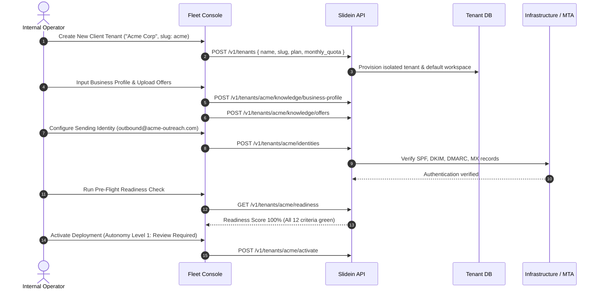
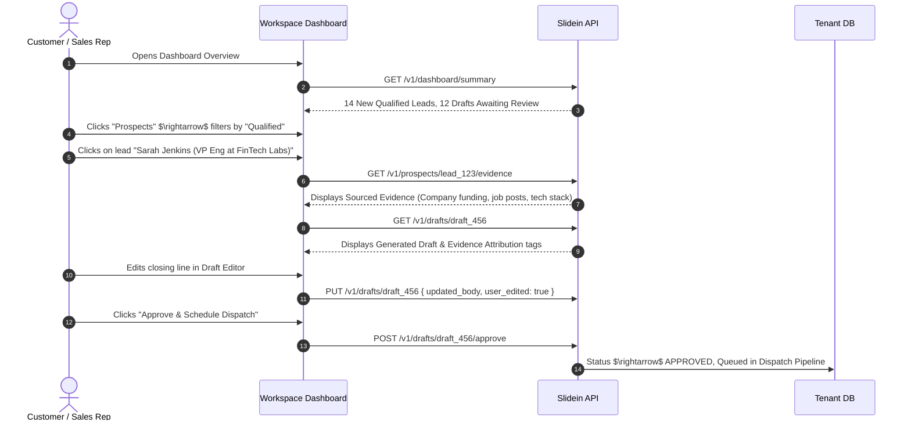
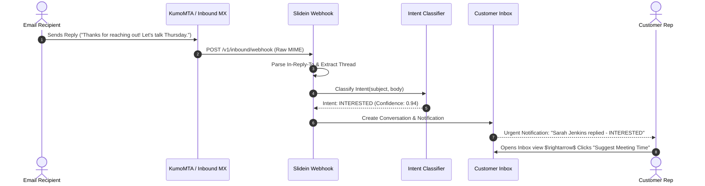

# SLIDEIN USER JOURNEYS & INTERACTION PATTERNS

> **End-to-End Operational Paths for Internal Operators & Tenant Customers**  
> Status: Active Specification

---

## Journey 1: Internal Operator Onboards a New Client Deployment

---

## Journey 2: Customer Reviews Qualified Prospects & Approves Drafts

---

## Journey 3: Autonomous Scheduled Discovery & Deliverability-Gated Dispatch

1. **Cron Trigger:** Scheduled worker wakes up according to tenant's quiet-hours and dispatch window.
2. **Quota & Rate Gate:** Checks hourly rate limit ($< 25/\text{hr}$), daily budget ($< 150/\text{day}$), and current bounce rate ($< 2.0\%$).
3. **Suppression Verification:** Checks recipient email against global suppression table (`deliverability_state.db`).
4. **Transport Submission:** Formats MIME message with DKIM signing and submits via KumoMTA SMTP (port 2587).
5. **Event Logging:** Records delivery event in `sent_messages` with unique `message_id`.

---

## Journey 4: Inbound Reply Handling & Unsubscribe / Meeting Flow

If recipient replies with *"Please unsubscribe me and take me off your list"*:
- Intent Classifier outputs: `UNSUBSCRIBE_REQUEST`.
- System instantly inserts recipient email and domain into `suppression_records`.
- Cancels any pending or future sequence follow-ups for this prospect.
- Emits audit log entry `SUPPRESSION_OPT_OUT`. No further outreach is possible.
