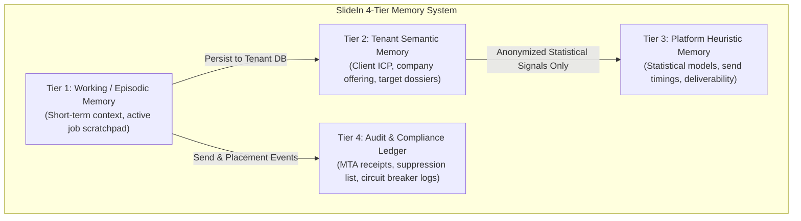

# SlideIn — Memory & Knowledge Architecture

> **Authority note (2026-10-16):** This root file is a high-level summary created before the engagement capability was documented.
> Where it differs from `docs/` (canonical layout, ADR-0002), **`docs/` prevails**. Figures marked as targets here (placement %, latency, price/cost,
> thresholds) are **proposals, not confirmed requirements**. Prospect Engagement (reply → chat/voice → meeting booking):
> `docs/product/PROSPECT_ENGAGEMENT.md`.


> **Version:** 1.0.0  
> **Status:** Draft summary  
> **Mandate:** Zero Cross-Tenant Data Contamination with Continuous Platform Intelligence  

---

## 1. Overview & Memory Taxonomy

To solve the multi-tenant SaaS dilemma (where an AI agent runs on behalf of a $350/mo subscriber without polluting other clients or shifting core platform behavior), SlideIn structures memory into four distinct tiers:



| Tier | Name | Scope | Lifetime | Data Partitioning |
|---|---|---|---|---|
| **Tier 1** | Working / Episodic | Single Agent Run | In-flight / Session | Ephemeral (RAM / Redis) |
| **Tier 2** | Tenant Semantic | Single Organization | Permanent / Tenant | Row-Level Security (`tenant_id`) |
| **Tier 3** | Platform Heuristic | Universal Platform | Rolling Aggregate | Anonymized Statistical Models |
| **Tier 4** | Audit & Ledger | Compliance & MTA | Immutable Append-Only | Structured Relational DB |

---

## 2. Tier Specifications

### 2.1 Tier 1: Working & Episodic Memory
- **Purpose:** Manages the active execution context of agentic tasks (e.g. scraping a specific company website, drafting an email variation, or analyzing an inbound reply).
- **Contents:**
  - Raw HTML scrapings and intermediary LLM reasoning chains.
  - Active tool execution traces and temporary API responses.
- **Eviction Policy:** Cleared immediately upon job completion or flushed to Tier 2 if user approves the generated output.

### 2.2 Tier 2: Tenant Semantic Memory (The Isolated Vault)
- **Purpose:** Stores the client-specific knowledge that powers customized outbound outreach.
- **Contents:**
  - **Tenant ICP Blueprint:** Target industries, revenue bands, geography, seniority levels, and pain points.
  - **Company Positioning & Voice:** Value propositions, case studies, founder backstory, approved sequence templates, and tone preferences.
  - **Prospect Dossiers:** Verified email addresses, enriched executive backgrounds, company news, and personalized angles.
  - **Conversation Histories:** Inbound replies, meeting transcripts, and objection patterns.
- **Security Invariant:** **Strict Hard Partitioning.** Stored with a cryptographic/relational lock to `tenant_id`. No vector similarity query or database scan may span multiple tenants.

### 2.3 Tier 3: Platform Heuristic Memory (The Platform Genome)
- **Purpose:** Allows the overall SaaS platform to become smarter, faster, and more effective with every campaign sent—without leaking proprietary client data.
- **What is Extracted (Safe Heuristics):**
  - **Deliverability Signatures:** Provider response times, greylisting patterns, and connection pacing per ESP (Google, M365, Yahoo).
  - **Optimal Send Windows:** Anonymized histograms of open and reply times grouped by recipient industry and timezone.
  - **Structural Copy Mechanics:** Anonymized metrics such as optimal subject line word count (e.g. 2–4 words), body length (e.g. 50–90 words), and question count.
  - **Spam Filter Heuristics:** Real-time updates on high-risk phrases flagged by spam engines.
- **What is FORBIDDEN in Tier 3:**
  - ❌ No company names, executive names, or contact email addresses.
  - ❌ No proprietary offer structures, pricing terms, or unique value propositions.
  - ❌ No raw email text or verbatim copy snippets.

### 2.4 Tier 4: Audit, Telemetry & Compliance Ledger
- **Purpose:** Maintains an immutable legal and deliverability audit trail.
- **Contents:**
  - KumoMTA injection and delivery receipts with DKIM signatures.
  - Bounce classification ledger (transient vs hard bounce).
  - Unsubscribe and suppression lists (global and tenant-scoped).
  - Circuit breaker trip events and recovery actions.

---

## 3. The Isolation Contract & Anti-Contamination Invariant

To guarantee complete separation between the universal platform and individual client workspaces, the following invariants are enforced:

### 3.1 Relational Storage Enforcement
```sql
-- Every query must strictly bind to tenant_id
SELECT * FROM prospects 
WHERE tenant_id = :current_tenant_id 
  AND status = 'verified';
```

### 3.2 Vector Embedding Namespacing
Vector representations of documents, ICP guidelines, and prospect profiles are isolated via partitioned index namespaces:
$$\text{VectorStoreNamespace} = \text{"tenant\_"} + \text{tenant\_id}$$

Similarity searches strictly reject cross-namespace lookups:
```python
results = vector_db.query(
    namespace=f"tenant_{current_tenant_id}",
    vector=query_embedding,
    top_k=5
)
```

### 3.3 Differential Sanitization Pipeline
Before any campaign event influences Tier 3 (Platform Genome), it passes through the Differential Sanitizer:
1. **Redact PII:** Remove all emails, domains, names, and phone numbers.
2. **Abstract Copy:** Convert text into structural metadata (word count, readability grade, sentiment score).
3. **Differential Aggregation:** Aggregate into general histograms using noise addition to guarantee k-anonymity.

---

## 5. Engagement Knowledge (PROPOSED)

Conversation data is `tenant_private` per `docs/architecture/TENANT_MEMORY_POLICY.md` (authoritative scopes). Agent knowledge is limited to approved, versioned, unexpired items classed
`verified_client` / `prospect_provided` / `agent_inferred` / `unconfirmed_review`. See `docs/product/PROSPECT_ENGAGEMENT.md` §6.
